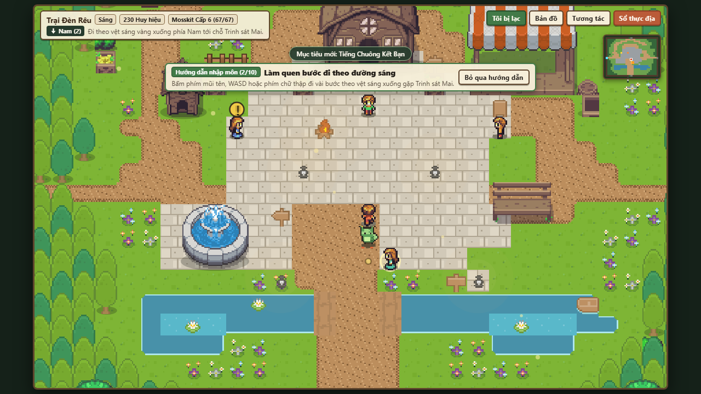
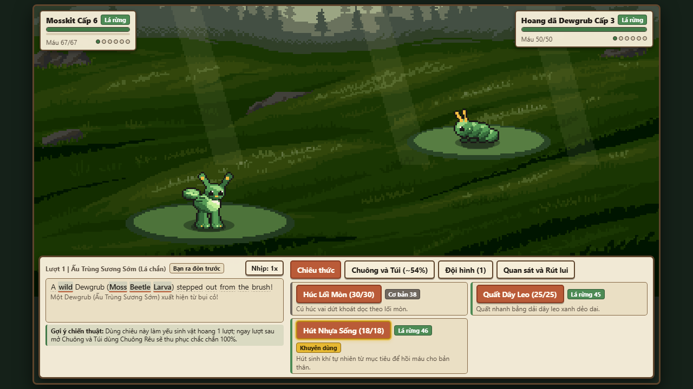
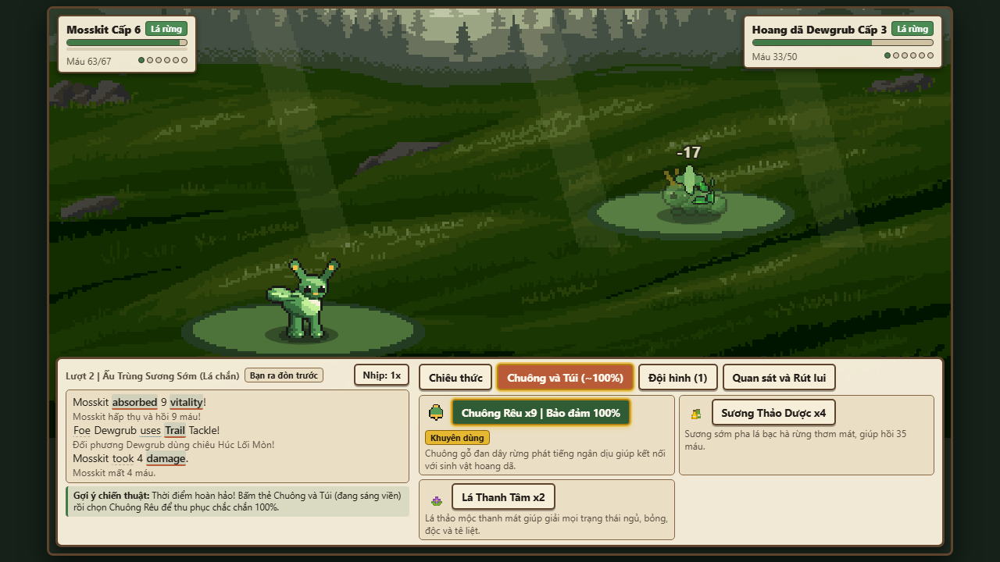
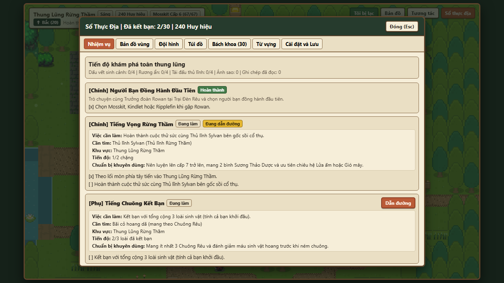
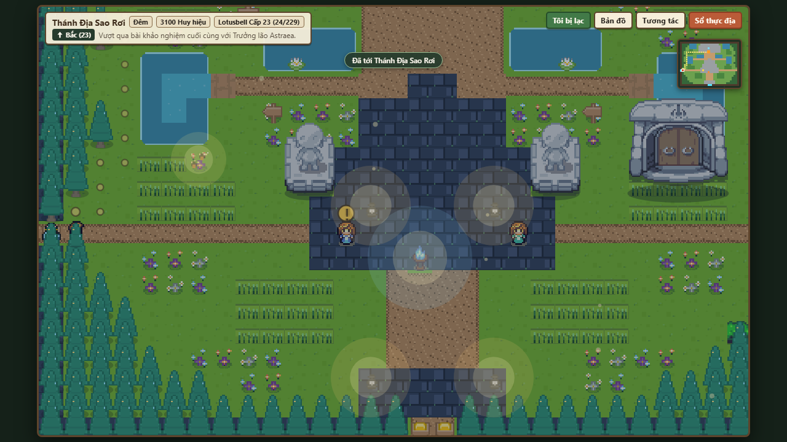

# LingoWild (v1.2.0)

LingoWild là trò chơi nhập vai thu phục sinh vật 2D chạy trực tiếp trên trình duyệt web, kết hợp tiếp thu tiếng Anh tự nhiên ngay trong ngữ cảnh thám hiểm. Phiên bản `1.2.0` tập trung hoàn thiện trải nghiệm người mới để người chơi Việt Nam chưa từng chơi thể loại nhập vai thu phục sinh vật và đang ở trình độ tiếng Anh cơ bản có thể mở lên và chơi ngay bằng tiếng Việt mà không cần đọc tài liệu ngoài, đồng thời dễ dàng nâng dần mức tiếng Anh và độ khó chiến đấu theo nhịp riêng.

Địa chỉ chơi trực tuyến trên GitHub Pages: https://nguyen-xuantung.github.io/Pokemon/

## 1. Điểm nhấn trải nghiệm và hỗ trợ người mới trong v1.2.0

- Tách độc lập ngôn ngữ giao diện, ngôn ngữ nội dung, trình độ tiếng Anh và độ khó chiến đấu: Người chơi mới mặc định bắt đầu với giao diện Tiếng Việt, nội dung Song ngữ Anh Việt, độ khó Thư giãn, dẫn đường Đầy đủ, Trợ giúp chiến đấu bật và hướng dẫn nhập môn bật. Mọi thiết lập đều đổi được trực tiếp trên màn hình mở đầu hoặc trong thẻ `Cài đặt và Lưu` giữa hành trình mà không mất tiến trình hay sổ từ vựng.
- Hệ thống dẫn đường thống nhất một mục tiêu duy nhất theo 3 mức (`Đầy đủ`, `Tối giản`, `Tắt`): Thanh HUD, mũi tên la bàn, số bước, vệt sáng mặt đất, bản đồ nhỏ và cửa sổ `Tôi bị lạc` luôn bám theo cùng một mục tiêu đang được ưu tiên (ưu tiên bước nhập môn khi đang hướng dẫn, chuyển sang nhiệm vụ đang theo dõi sau khi hoàn tất hoặc bỏ qua). Khi tới nơi hiển thị rõ nhãn `Đã tới nơi` cùng nút tương tác; không chỉ đường xuyên vật cản, không qua cổng chưa mở khóa, không dẫn tới mục tiêu đã xong và giải thích rõ khi lối đi bị khóa hoặc bị chặn.
- Trợ giúp chiến đấu một khuyến nghị chính duy nhất mỗi lượt: Tại mỗi thời điểm chỉ làm nổi bật đúng một hành động phù hợp nhất: ưu tiên hồi máu khi thấp máu, làm nổi bật thẻ `Chuông và Túi` cùng chuông phù hợp khi sẵn sàng thu phục chắc chắn 100% (tắt nhãn khuyên dùng trên các chiêu tấn công để không gây nhiễu), gợi ý đổi đồng đội khắc hệ khi gặp bất lợi nguyên tố bằng tiếng Việt dễ hiểu, hoặc khuyên dùng một chiêu tấn công kèm cảnh báo nếu chiêu mạnh có nguy cơ đánh ngất sinh vật hoang ngoài ý muốn. Trước khi gặp Thủ lĩnh có nhắc chuẩn bị cấp độ, hệ khắc chế, hồi máu và vật phẩm; có lưới an toàn cấp thêm Chuông Rêu dự phòng ở chế độ Thư giãn nếu người mới dùng hết chuông và thiếu huy hiệu.
- Hướng dẫn nhập môn 10 bước trực quan kèm xem lại bất cứ lúc nào: Mỗi bước trả lời rõ cần làm gì, đi đâu và bấm nút nào, tự làm sáng viền nút cần thao tác (`Tương tác`, `Sổ thực địa`), bảo đảm thu phục 100% ở lần bắt hướng dẫn đầu tiên sau 1 lượt đánh, cho phép bỏ qua bước tra từ tiếng Anh hoặc bỏ qua toàn bộ hướng dẫn mà không mất vật phẩm hay tiến trình. Trong `Tôi bị lạc` có thêm bảng `Xem nhanh 8 bước cho người mới` và nút `Bật lại gợi ý từng bước`.
- Thế giới 5 vùng sinh thái cỡ `32x24`, 30 loài sinh vật và hậu cốt truyện: Khám phá Trại Đèn Rêu, Thung Lũng Rừng Thầm, Đầm Sậy Nước Trong, Đèo Đất Nung và Thánh Địa Sao Rơi cùng bạn đồng hành đi theo sau, 42 chiêu thức 6 nguyên tố trên 5 sân đấu pixel vẽ riêng, biến thể ánh kim hiếm, 4 dấu vết sinh cảnh, 12 nhiệm vụ có cấu trúc chi tiết, Quản lý chiêu trong thẻ Đội hình và 4 trận tái đấu bậc thầy cấp `24` đến `30` sau cốt truyện.
- Tiếp thu tiếng Anh tự nhiên không cưỡng ép: 367 mục từ và cụm từ lõi đa nghĩa theo ngữ cảnh kèm phiên âm, từ loại và câu ví dụ độc lập, kết hợp từ điển gốc từ bỏ túi ngoại tuyến hơn 430 mục (`src/data/pocket-dict.ts`) đạt độ phủ chạm tra nghĩa `90,5%` trong 192 đoạn hội thoại từ A1 đến B2, tuyệt đối không chặn tiến trình bằng bài kiểm tra từ vựng bắt buộc.

## 2. Ảnh chụp màn hình thực tế và video gameplay

Video quay trực tiếp hành trình mở đầu của người chơi mới từ màn hình mở đầu tiếng Việt `v1.2.0`, chọn bạn đồng hành, theo mũi tên và vệt sáng gặp Trinh sát Mai, sang Rừng Thầm chiến đấu với Trợ giúp chiến đấu và thu phục chắc chắn sinh vật đầu tiên, hồi máu tại lửa trại, xem Sổ Thực Địa, quản lý chiêu thức, dùng nút `Tôi bị lạc` cùng bảng xem nhanh 8 bước được lưu tại [docs/videos/lingowild-gameplay.webm](docs/videos/lingowild-gameplay.webm).














Trọn bộ 23 ảnh chụp thực tế của tất cả khu vực, trải nghiệm người mới, hội thoại tra từ, lửa trại, sổ thực địa, màn kết thúc và di động dọc ngang nằm trong thư mục [docs/screenshots/](docs/screenshots/).

## 3. Hướng dẫn chơi và điều khiển

### Tùy chỉnh ngôn ngữ, độ khó và dẫn đường
Ngay tại màn hình mở đầu hoặc bất kỳ lúc nào trong thẻ `Cài đặt và Lưu` của Sổ Thực Địa, người chơi có thể thay đổi trực tiếp bốn thiết lập độc lập:
- Ngôn ngữ giao diện: Tiếng Việt hoặc Tiếng Anh.
- Ngôn ngữ hội thoại và nội dung: Tiếng Việt hoàn toàn, Song ngữ Anh Việt, Tiếng Anh có trợ giúp tra cứu hoặc Đắm chìm trong tiếng Anh (kèm mức câu thoại A1 đến B2).
- Độ khó chiến đấu: Thư giãn (khuyên dùng cho người mới), Phiêu lưu (cân bằng chuẩn) hoặc Thử thách (đối thủ chọn chiêu chiến thuật hơn, không bơm máu kéo dài trận).
- Mức dẫn đường và Trợ giúp chiến đấu: Chọn dẫn đường Đầy đủ, Tối giản hoặc Tắt; bật hoặc tắt thanh Trợ giúp chiến đấu và xem lại hướng dẫn bất cứ lúc nào.

### Điều khiển trên máy tính và di động
- Trên máy tính: Di chuyển bốn hướng bằng phím mũi tên hoặc `W`, `A`, `S`, `D`; tương tác với nhân vật, biển chỉ đường, rương đồ, lửa trại và chuyển thoại bằng `Space` hoặc `Enter` (hỗ trợ tự quay mặt về đối tượng ngay cạnh); chọn nhanh bốn chiêu thức trong trận đấu bằng phím số `1`, `2`, `3`, `4`; mở nhanh Bản đồ vùng bằng phím `M`; mở Sổ Thực Địa bằng phím `J`; đóng cửa sổ bằng `Escape`. Các phím điều khiển chính đều gán lại được trong mục Cài đặt.
- Trên điện thoại và máy tính bảng: Khung trò chơi phủ kín màn hình dọc lẫn ngang không méo tỷ lệ điểm ảnh. Cụm phím chữ thập bên trái hỗ trợ bấm từng bước và nhấn giữ để bước liên tục; bản đồ nhỏ đặt gọn phía trên cụm nút cảm ứng bên phải để tránh che thanh mục tiêu và khung hướng dẫn phía trên.

## 4. Kiến trúc hệ thống, lưu trữ an toàn và vận hành ngoại tuyến

Mã nguồn viết bằng TypeScript nghiêm ngặt (`strict: true`, `noUncheckedIndexedAccess: true`), tách biệt hoàn toàn tầng nghiệp vụ thuần khỏi giao diện hiển thị để kiểm thử xác định mà không phụ thuộc DOM hay WebGL:

| Thư mục hoặc tệp | Vai trò trong kiến trúc |
| --- | --- |
| `src/domain/` | Nghiệp vụ thuần: bản địa hóa (`i18n.ts`), độ khó (`difficulty.ts`), tìm đường BFS và định hướng thống nhất (`navigation.ts`), hướng dẫn nhập môn (`onboarding.ts`), trợ giúp chiến đấu một khuyến nghị chính (`battleAssist.ts`), công thức nguyên tố, lượt đấu, thu phục, quản lý chiêu thức, học từ vựng và di trú tệp lưu |
| `src/data/` | Dữ liệu tĩnh đã kiểm định: 30 loài, 42 chiêu kèm tên tiếng Việt, 13 vật phẩm, 5 bản đồ `32x24`, 16 nhân vật phụ, 12 nhiệm vụ, 367 mục từ lõi, từ điển gốc từ bỏ túi và 192 hội thoại |
| `src/game/controller.ts` | Bộ điều phối trung tâm kết nối trạng thái trò chơi, đồng hành đi theo sau, cập nhật dẫn đường theo sự kiện rời rạc, lưới an toàn vật phẩm người mới, lưu tự động, âm thanh và giao diện |
| `src/scenes/WorldScene.ts` | Cảnh dựng hình Phaser 3 vẽ bản đồ phân lớp, vệt sáng dẫn đường lưu đệm theo chữ ký, dấu nhiệm vụ trên nhân vật, hạt môi trường và sân đấu pixel |
| `src/ui/` | Giao diện tiếng Việt và tiếng Anh đầy đủ cho màn hình mở đầu, thanh mục tiêu kèm la bàn và bản đồ nhỏ, Sổ Thực Địa 7 thẻ, hộp thoại từ vựng, cửa sổ Tôi bị lạc, cửa sổ Giấy phép và Ghi công cùng bảng chiến đấu hai cột |
| `src/audio/soundEngine.ts` | Bộ tổng hợp nhạc nền theo vùng và hiệu ứng âm thanh bằng Web Audio API kết hợp đọc phát âm qua Web Speech API |
| `public/sw.js` và `scripts/inject-sw-manifest.ts` | Trình phục vụ ngoại tuyến định danh phiên bản `SHA-256` theo nội dung byte của danh sách 16 tài nguyên sắp xếp xác định (bao gồm `LICENSE.txt` và `CREDITS.md` phân phối cùng gói web) |

Các cơ chế an toàn dữ liệu và ngoại tuyến đã triển khai:
- Di trú tệp lưu tương thích ngược (`SAVE_SCHEMA_VERSION = 2`): Bản lưu cũ từ phiên bản `1.0` và `1.1` (bao gồm bản lưu đang tồn tại của người chơi trên GitHub Pages) tự động bổ sung các trường trải nghiệm người mới một cách an toàn mà không mất đội hình, huy hiệu, nhiệm vụ hay sổ từ vựng.
- Bảo vệ đa thẻ và đầy bộ nhớ: Kiểm tra dấu thời gian mới hơn từ thẻ trình duyệt khác (`hasMultiTabConflict`), giữ nguyên bản sao lưu dự phòng khi gặp lỗi `QuotaExceededError` và bảo toàn bản lưu đang chơi khi nhập tệp `.json` hỏng (mọi thông báo lỗi đều hiển thị tiếng Việt tự nhiên).
- Ngoại tuyến tin cậy: `public/sw.js` chỉ quản lý kho đệm mang tiền tố `lingowild-cache-`, dùng `async/await` tường minh cho dự phòng điều hướng ngoại tuyến và trả mã `503` rõ ràng cho tài nguyên con thất bại.

## 5. Nguồn tài nguyên mở, giấy phép mã nguồn và phân phối cùng gói web

Thông tin giấy phép và ghi công tài nguyên được phân phối trực tiếp trong cả mã nguồn lẫn bản đóng gói web tại cửa sổ `Giấy phép và Ghi công` trong trò chơi (truy cập ngay từ màn hình mở đầu và mục Cài đặt) cũng như hai tệp tĩnh `./LICENSE.txt` và `./CREDITS.md` lưu trong `dist/` (xem chi tiết tại [CREDITS.md](CREDITS.md) và [LICENSE](LICENSE)):

| Bộ tài nguyên hoặc thành phần | Tác giả | Giấy phép áp dụng | Phạm vi sử dụng trong LingoWild |
| --- | --- | --- | --- |
| Mã nguồn, dữ liệu ngôn ngữ và âm thanh tổng hợp | Nhóm phát triển LingoWild | MIT ([LICENSE](LICENSE)) | Toàn bộ mã trong `src/`, `scripts/`, `tests/`, `public/sw.js` và dữ liệu hội thoại, từ vựng |
| Sinh vật, đồng hành và hiệu ứng vẽ riêng | Nhóm phát triển LingoWild | MIT ([LICENSE](LICENSE)) | 30 loài sinh vật `48x48` (`creatures.png`), 30 đồng hành `16x16` (`companions.png`), vật phẩm (`items.png`), hiệu ứng (`vfx.png`) và đường đất đỏ tự nối |
| `Roguelike/RPG Pack` | Kenney Vleugels | CC0 1.0 Universal | Thảm cỏ, mặt nước động, bờ nước tự nối, cầu gỗ, thuyền neo, tán cây và lửa trại trong `tileset.png` |
| `Zelda-like tilesets and sprites` | ArMM1998 | CC0 1.0 Universal | Nhà gỗ `5x5`, chòi gỗ, quầy chợ, cổng vòm đá cổ `4x4`, đài phun nước ba nhịp, ghế gỗ, thân cây rỗng, tượng đá và thác nước `3x3` trong `structures.png` |
| `Tiny 16: Basic` | Lanea Zimmerman (`Sharm`) | CC-BY 3.0 / CC-BY 4.0 | Nhân vật bốn hướng trong `characters.png`, rương gỗ, bậc đá, đá lát rêu, vách đá phân tầng và ván cầu trong `tileset.png` |
| `Hazy Hills` và `Gothicvania Swamp` | Luis Zuno (`@ansimuz`) | CC-BY 3.0 và CC0 1.0 | Nền đồi rừng mờ sương (CC-BY 3.0) và tán cây đầm lầy (CC0 1.0) trong `battle-bg.png` |
| `Parallax Backgrounds` | Admurin | CC-BY 4.0 | Núi xa, đồng cỏ, bến cọc gỗ và đỉnh núi sao đêm trong `battle-bg.png` |
| `Sunset Temple Tiles` | Pyromantic | CC0 1.0 / CC-BY 3.0 | Tầng mây hoàng hôn hẻm núi cho sân đấu Đèo Đất Nung trong `battle-bg.png` |

## 6. Kết quả kiểm thử thực tế, độ phủ mã nguồn và lệnh chạy

Yêu cầu hệ thống: Node.js từ `22.6` trở lên (đã kiểm định trên Node.js `v24.14.0`, npm `11.9.0` và quy trình GitHub Actions Ubuntu).

```bash
# Cài đặt gói phụ thuộc đúng phiên bản khóa
npm ci --ignore-scripts

# Kiểm tra lỗ hổng bảo mật cây phụ thuộc
npm audit --audit-level=low

# Chạy máy chủ phát triển tại http://localhost:5173
npm run dev

# Sinh 8 bảng ảnh pixel, kiểm định dữ liệu, kiểm tra kiểu, đóng gói dist/, sao chép giấy phép và băm danh mục ngoại tuyến
npm run build

# Xem thử bản đóng gói chính thức tại http://127.0.0.1:4173
npm run preview

# Chạy kiểm tra quy tắc, kiểm thử đơn vị và tích hợp kèm độ phủ V8, kiểm thử trình duyệt đầu cuối
npm run lint
npm run test:coverage
npm run test:e2e
```

Tóm tắt kết quả kiểm định tự động (báo cáo chi tiết tại [docs/TEST_REPORT.md](docs/TEST_REPORT.md)):
- Bảo mật và toàn vẹn dữ liệu: `npm audit --audit-level=low` đạt `0` lỗ hổng; `npm run validate:data` xác nhận liên thông 5 bản đồ, đủ 30 loài, 42 chiêu, 12 nhiệm vụ, 367 mục từ lõi và độ phủ tra từ `90,5%`; `npm run lint` và `npm run typecheck` đạt `0` lỗi.
- Kiểm thử đơn vị và tích hợp (`vitest`): Vượt qua `36/36` bài kiểm thử (`6/6` tệp), gồm 3 lượt phá đảo tự nhiên ở độ khó Phiêu lưu và 3 lượt phá đảo tự nhiên ở độ khó Thư giãn với ngưỡng luyện cấp thấp hơn hẳn cho cả `Mosskit`, `Kindlet` và `Ripplefin`, cùng 9 nhóm kiểm thử chuyên sâu trải nghiệm người mới.
- Độ phủ V8 trên phạm vi được đo (`src/domain/**/*.ts` và `src/game/controller.ts`, không tính giao diện DOM, cảnh Phaser hay dữ liệu tĩnh): Toàn phạm vi được đo đạt `76,44%` câu lệnh, `78,91%` dòng mã, `71,64%` nhánh và `60,04%` hàm (các mô-đun nghiệp vụ lõi như `battle.ts`, `battleAssist.ts`, `capture.ts`, `difficulty.ts`, `navigation.ts`, `learning.ts`, `creatures.ts` đạt từ `86%` đến `100%` dòng mã).
- Kiểm thử trình duyệt đầu cuối (`playwright`): Vượt qua toàn bộ `12/12` bài kiểm thử hoạt động trên Chromium máy tính (`1280x720`) và điện thoại Pixel 7 dọc ngang (`412x915`, `915x412`), bao gồm kịch bản tự đọc và bước theo mũi tên la bàn trên màn hình không cần tọa độ cứng, kiểm chứng một khuyến nghị chiến đấu duy nhất mỗi lượt, di trú bản lưu production `v1.1`, truy cập `LICENSE.txt` và `CREDITS.md` từ gói web, kiểm toán `0` nhãn tiếng Anh bị lọt, phá đảo toàn bộ cốt truyện và nâng cấp service worker bản A sang bản B.

## 7. Tài liệu dự án và giới hạn thực tế

Danh mục tài liệu đi kèm:
- [Hướng dẫn chơi chi tiết](docs/HOW_TO_PLAY.md)
- [Quyết định kỹ thuật và kiến trúc](docs/TECHNICAL_DECISION.md)
- [Báo cáo kiểm thử, độ phủ và đánh giá chơi thử](docs/TEST_REPORT.md)
- [Danh mục kiểm tra bàn giao phát hành](docs/RELEASE_CHECKLIST.md)
- [Ghi công và nguồn gốc tài nguyên](CREDITS.md)
- [Nghiên cứu sản phẩm ban đầu](docs/RESEARCH.md)
- [Quy tắc triển khai](AGENTS.md)

Giới hạn thực tế và lưu ý:
- Toàn bộ kiểm chứng hiện tại là kiểm thử tự động, kiểm chứng trình duyệt trên trang phát hành thật và tự rà soát của nhóm phát triển; sản phẩm chưa có đợt khảo sát định lượng trên nhóm người chơi mới hoàn toàn bên ngoài.
- Trò chơi vận hành hoàn toàn phía máy khách cho một người chơi, lưu dữ liệu cục bộ kèm xuất nhập tệp `.json` thủ công, không có tài khoản trực tuyến hay đồng bộ đám mây.
- Chất lượng giọng đọc tiếng Anh qua Web Speech API phụ thuộc vào gói giọng nói cài sẵn của từng hệ điều hành và trình duyệt.
- LingoWild là tên làm việc tạm thời, chưa đăng ký nhãn hiệu và hoàn toàn độc lập với The Pokémon Company hay Nintendo.
