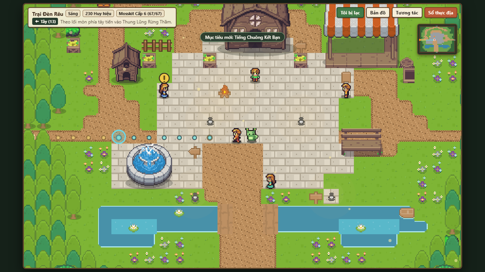
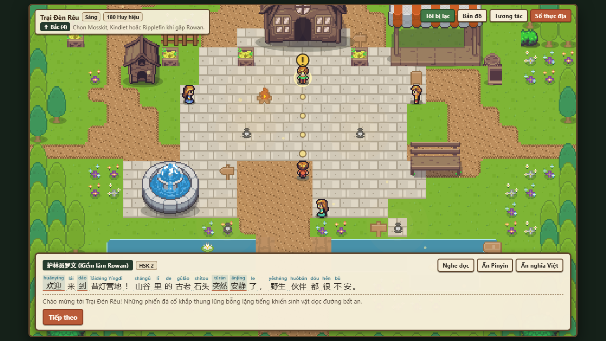
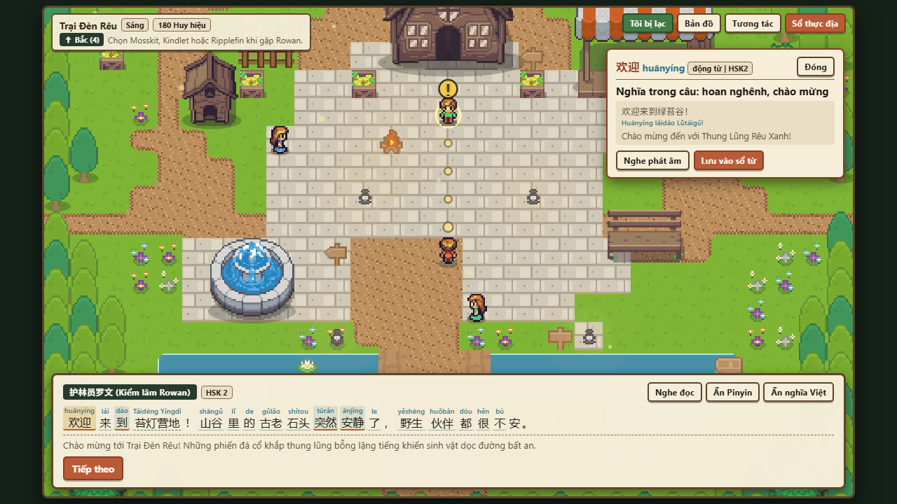
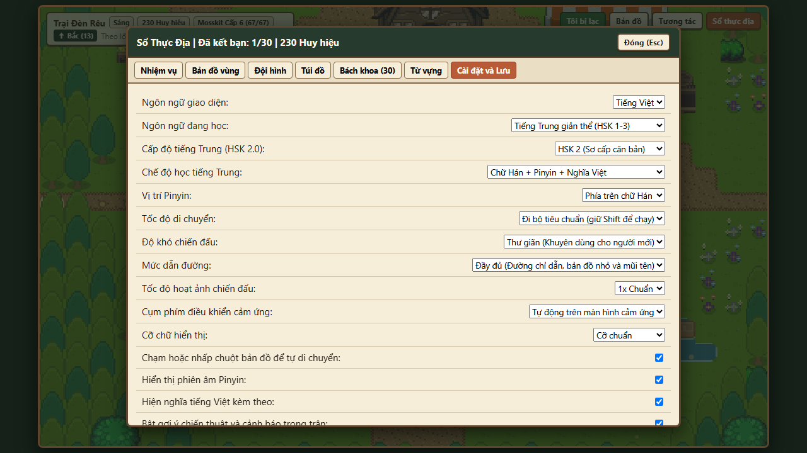
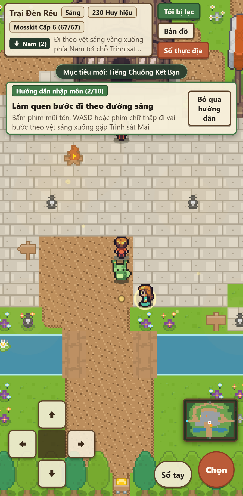

# LingoWild (v1.3.0)

LingoWild là trò chơi nhập vai thu phục sinh vật 2D chạy trực tiếp trên trình duyệt web, kết hợp tiếp thu tiếng Anh và tiếng Trung giản thể tự nhiên ngay trong ngữ cảnh thám hiểm. Phiên bản `1.3.0` xây dựng trên nền trải nghiệm người mới của `v1.2.0` và bổ sung ba nâng cấp lớn: nhấp chuột hoặc chạm bản đồ để tự tìm đường, hệ thống di chuyển liên tục mượt mà thống nhất cho mọi thiết bị nhập, và kiến trúc học đa ngôn ngữ với bộ dữ liệu tiếng Trung chuẩn HSK 2.0 đã kiểm định.

Địa chỉ chơi trực tuyến trên GitHub Pages: https://nguyen-xuantung.github.io/Pokemon/

## 1. Ba nâng cấp trọng tâm trong v1.3.0

- Nhấp chuột hoặc chạm bản đồ để tự tìm đường: Người chơi có thể nhấn trực tiếp vào ô bất kỳ trên bản đồ để nhân vật tìm đường ngắn nhất bằng BFS và bước lần lượt qua từng ô. Hệ thống tự chuyển tọa độ màn hình sang tọa độ thế giới theo camera, tỷ lệ phóng và thay đổi kích thước khung hình; hiển thị đường đi tạm màu xanh lam và vòng đích tách biệt với vệt dẫn đường nhiệm vụ màu vàng; hủy đường khi bấm phím điều hướng thủ công hoặc chọn đích mới; từ chối gọn khi bấm vào nước, cây, nhà cửa; tự đi đến cạnh nhân vật, biển chỉ đường, rương, lửa trại để tương tác một lần hoặc bước vào cổng chuyển vùng đã mở khóa (giải thích rõ điều kiện nếu cổng còn khóa). Toàn bộ sự kiện theo bước như gặp sinh vật hoang, đổi thời gian, tiến trình nhiệm vụ và đồng hành đi theo sau đều được giữ nguyên; khi vào trận chiến hay mở hộp thoại đường tự di chuyển bị hủy để không đi tiếp ngoài ý muốn. Tính năng bật tắt được trong phần Cài đặt.
- Di chuyển liên tục mượt mà thống nhất: Thay thế vòng lặp lệ thuộc sự kiện lặp phím của hệ điều hành và bộ đếm cảm ứng `135 ms` độc lập của `v1.2.0` bằng một bộ điều phối duy nhất (`src/game/movement.ts`) phục vụ bàn phím `WASD`, phím mũi tên, phím gán lại, phím chữ thập cảm ứng, tự tìm đường và tốc độ đi bộ hoặc chạy (giữ `Shift` hoặc chọn chế độ chạy). Tách tọa độ ô lưới nghiệp vụ khỏi tọa độ hiển thị nội suy, đồng bộ mượt hoạt ảnh bước đi, bóng nhân vật, đồng hành và camera độc lập tốc độ khung hình (`30`, `60`, `120 Hz`), giữ nguyên chế độ giảm chuyển động và loại bỏ việc xóa toàn bộ cây DOM giao diện ở mỗi bước (`0` lần xóa gốc DOM so với `36` lần trong `v1.2.0`).
- Kiến trúc học đa ngôn ngữ và hỗ trợ tiếng Trung giản thể chuẩn HSK 2.0: Mở rộng trực tiếp trên một bộ điều phối và giao diện thống nhất, tách rõ ngôn ngữ giao diện (`Tiếng Việt` hoặc `Tiếng Anh`), ngôn ngữ đang học (`Tiếng Anh CEFR A1-B2`, `Tiếng Trung giản thể HSK 1-3` hoặc `Không học ngoại ngữ`), trình độ riêng cho từng ngôn ngữ (không gán tương đương tùy tiện giữa CEFR và HSK), chế độ hiển thị, vị trí Pinyin (phía trên hoặc phía dưới chữ Hán), bật tắt Pinyin và nghĩa tiếng Việt độc lập. Hệ thống ưu tiên chất lượng sơ cấp quanh `HSK 2`, hỗ trợ tra nghĩa 10 trường theo ngữ cảnh, tách riêng tên riêng trong game khỏi danh mục HSK, phát âm tiếng Trung chuẩn `zh-CN` (tuyệt đối không dùng giọng tiếng Anh đọc chữ Hán), ôn tập tự nguyện bên lửa trại bằng 3 dạng câu hỏi tiếng Trung, tách hai sổ từ vựng Anh và Trung độc lập và cho phép chuyển đổi ngôn ngữ học ngay giữa hành trình mà không mất đội hình, huy hiệu hay tiến trình.

## 2. Ảnh chụp màn hình thực tế và video gameplay

Bộ video quay trực tiếp trên bản đóng gói chính thức của `v1.3.0`:
- [docs/videos/v130-click-to-move.webm](docs/videos/v130-click-to-move.webm): Nhấp chuột tự tìm đường quanh vật cản, hiển thị đường đi xanh lam, từ chối ô nước, tự đi tới biển chỉ đường và Trinh sát Mai, rồi đi qua cổng tây sang Thung Lũng Rừng Thầm (`19,5` giây).
- [docs/videos/v130-smooth-movement.webm](docs/videos/v130-smooth-movement.webm): Nhấn giữ phím di chuyển liên tục không khựng giữa các ô, đổi hướng tức thì, giữ `Shift` để chạy mượt và dừng đúng ô khi thả phím (`13,1` giây).
- [docs/videos/v130-chinese-hsk2.webm](docs/videos/v130-chinese-hsk2.webm): Khởi đầu bằng tiếng Trung `HSK 2`, bật tắt Pinyin, chạm tra phiếu 10 trường cho từ `欢迎`, xem thẻ tên riêng `苔灯营地`, kiểm tra phát âm và lưu từ, sau đó mở ôn tập tiếng Trung tự nguyện bên lửa trại (`17,2` giây).
- [docs/videos/v130-language-switch.webm](docs/videos/v130-language-switch.webm): Chuyển đổi trực tiếp giữa tiếng Trung và tiếng Anh ngay trong phần Cài đặt, chứng minh đội hình, huy hiệu và cả hai sổ từ vựng Anh và Trung đều được bảo toàn nguyên vẹn (`17,8` giây).
- [docs/videos/lingowild-gameplay.webm](docs/videos/lingowild-gameplay.webm): Hành trình mở đầu trọn vẹn của người chơi mới bằng tiếng Việt từ màn hình mở đầu tới trận chiến, thu phục 100%, Sổ Thực Địa và `Tôi bị lạc`.













Trọn bộ 27 ảnh chụp thực tế của cả 5 vùng sinh thái, trải nghiệm người mới, tự tìm đường, tiếng Trung HSK 2, trận chiến, sổ thực địa, màn kết thúc và di động dọc ngang nằm trong thư mục [docs/screenshots/](docs/screenshots/).

## 3. Tóm tắt số liệu chuyển động và dữ liệu tiếng Trung HSK 2.0

### So sánh đo chuyển động thực tế (Chromium `1280x720`)

| Tiêu chí đo thực tế | Bản v1.2.0 trước nâng cấp | Bản v1.3.0 sau nâng cấp |
| --- | --- | --- |
| Giữ phím bàn phím (`ArrowLeft`) liên tục | Chỉ di chuyển `1` ô (lệ thuộc lặp phím hệ điều hành) | Di chuyển liên tục `30` ô suốt chuỗi đi bộ, đảo chiều và chạy |
| Nhịp bước đi bộ khi giữ phím | Không giữ liên tục bằng bàn phím; cảm ứng `136,9 ms` với tween `92 ms` tạo khoảng đứng khựng `~45 ms` mỗi ô | Trung bình `164,9 ms/ô` (`149` đến `168 ms`, khớp mốc `165 ms`), không có khoảng dừng giữa các ô |
| Nhịp bước chạy khi giữ `Shift` | Chưa có chế độ chạy | Trung bình `110,1 ms/ô` (`97` đến `120 ms`, khớp mốc `110 ms`) |
| Số lần xóa và dựng lại gốc DOM giao diện khi di chuyển | `36` lần trong 9 bước | `0` lần trong suốt 30 bước |
| Số khung hình nội suy vị trí mượt được ghi nhận | Hủy và tạo lại tween ngắt quãng mỗi bước | `261` khung hình nội suy liên tục, camera bám mượt ở `30/60/120 Hz` |

### Phạm vi và nguồn dữ liệu tiếng Trung (chuẩn HSK 2.0)

- Chuẩn áp dụng: HSK 2.0 (Hanban 2012), sử dụng chữ Hán giản thể, tách rõ cấp độ HSK khỏi CEFR và chỉ công bố phủ đầy đủ từ **HSK 1 đến HSK 3** (các mục `HSK 4` chỉ mang tính bổ trợ thêm cho hội thoại, không công bố phủ toàn bộ HSK 4).
- Nguồn công khai đã xác minh giấy phép (truy xuất ngày `2026-11-28`, xem chi tiết trong [CREDITS.md](CREDITS.md)): đối chiếu danh mục từ và Pinyin từ `sawcordwell/HSK-Vocab` (CC0 1.0) và `drkameleon/complete-hsk-vocabulary` (MIT); không sao chép nghĩa CC-CEDICT hay câu ví dụ copyleft; toàn bộ nghĩa tiếng Việt và câu ví dụ gắn với thế giới LingoWild được biên soạn mới theo giấy phép MIT và kiểm định tự động bằng `scripts/verify-hsk-data.ts`.
- Phân biệt rõ số lượng trong bộ từ điển và số lượng xuất hiện trong câu thoại thực tế của game:
  - Bộ từ điển tiếng Trung (`src/data/zh-lexicon-*.ts`): `985` mục từ gồm `150` mục `HSK 1` (đủ `100%`), `150` mục `HSK 2` (đủ `100%`), `298` đầu mục `HSK 3` cộng `2` cách đọc đa âm chính thức của HSK 3 (`还 huán`, `长 zhǎng`) thành đủ `300` mục `HSK 3` (`100%`), `73` mục bổ trợ `HSK 4` và `314` từ chuyên ngành thiên nhiên, phiêu lưu không gán nhãn HSK; cộng `55` mục tên riêng vùng đất, nhân vật và sinh vật tách hoàn toàn khỏi HSK.
  - Nội dung tiếng Trung trong game (`npm run validate:data`): phủ toàn bộ `192` đoạn hội thoại (gồm `98` đoạn có biến thể câu theo cấp HSK), `30` loài sinh vật, `42` chiêu thức, `13` vật phẩm, `12` nhiệm vụ, `5` bản đồ, `16` nhân vật phụ và toàn bộ nhật ký trận đấu; có `640` từ riêng biệt từ bộ từ điển xuất hiện trực tiếp trong câu thoại và mô tả (`HSK 1: 95`, `HSK 2: 87`, `HSK 3: 124`, bổ trợ `HSK 4: 45`, từ ngữ cảnh không gán HSK: `289`), đạt độ phủ chạm tra từ `84,7%` (tiếng Anh đạt `90,5%`).

## 4. Hướng dẫn điều khiển và tương thích tệp lưu

- Điều khiển máy tính: Nhấp chuột trực tiếp vào bản đồ để tự tìm đường và tương tác; hoặc dùng phím mũi tên, `W`, `A`, `S`, `D` (nhấn giữ đi mượt liên tục), giữ `Shift` để chạy; `Space` hoặc `Enter` tương tác và qua thoại; `1`, `2`, `3`, `4` chọn nhanh chiêu trong trận; `M` mở Bản đồ; `J` mở Sổ Thực Địa; `Escape` đóng cửa sổ. Phím tắt chính gán lại được trong Cài đặt.
- Điều khiển di động: Chạm trực tiếp vào khung bản đồ để tự di chuyển ở cả màn hình dọc và ngang, hoặc nhấn giữ cụm phím chữ thập bên trái để đi liên tục.
- Tương thích tệp lưu (`SAVE_SCHEMA_VERSION = 3`): Tự động di trú an toàn bản lưu `v1.0`, `v1.1` và `v1.2.0` đang lưu cục bộ trên trình duyệt sang cấu trúc `v1.3.0` (bổ sung cài đặt đa ngôn ngữ, tự tìm đường, tốc độ di chuyển và sổ từ tiếng Trung riêng `lexiconZh`) mà không làm mất đội hình, huy hiệu, nhiệm vụ hay sổ từ tiếng Anh cũ.

## 5. Kiến trúc hệ thống và nguồn tài nguyên mở

Mã nguồn viết bằng TypeScript nghiêm ngặt (`strict: true`, `noUncheckedIndexedAccess: true`), không bổ sung gói phụ thuộc bên ngoài mới cho `v1.3.0`:

| Thư mục hoặc tệp | Vai trò trong kiến trúc |
| --- | --- |
| `src/domain/` | Nghiệp vụ thuần: tìm đường BFS và lập kế hoạch tự di chuyển (`navigation.ts`), tách từ và xử lý đa âm đa nghĩa tiếng Trung (`chinese.ts`), học tiếng Anh (`learning.ts`), bản địa hóa (`i18n.ts`), độ khó, chiến đấu, thu phục, hướng dẫn nhập môn và di trú tệp lưu v3 (`save.ts`) |
| `src/game/movement.ts` | Bộ điều phối di chuyển hợp nhất duy nhất cho bàn phím, cảm ứng, tự tìm đường, chạy và nội suy vị trí mượt tách khỏi tọa độ lưới |
| `src/game/controller.ts` | Bộ điều phối trung tâm quản lý trạng thái trò chơi, đồng hành, hội thoại song ngữ Anh và Trung, ôn tập lửa trại, lưu tự động và âm thanh |
| `src/data/` | Dữ liệu tĩnh đã kiểm định cho 5 bản đồ `32x24`, 30 loài, 42 chiêu, 13 vật phẩm, 12 nhiệm vụ, 16 NPC, 367 từ lõi tiếng Anh kèm từ điển bỏ túi, `985` từ tiếng Trung HSK 2.0 kèm `55` tên riêng và 192 đoạn hội thoại đủ cả Anh, Trung và Việt |
| `src/scenes/WorldScene.ts` | Cảnh dựng hình Phaser 3 xử lý chuyển tọa độ nhấp chuột, vẽ đường tự di chuyển màu xanh lam, camera bám mượt độc lập FPS, lớp kiến trúc và sân đấu pixel |
| `src/ui/` | Giao diện cập nhật tăng dần không xóa gốc DOM khi đi bộ, bản đồ nhỏ đệm địa hình, hộp thoại Pinyin trên/dưới, phiếu tra từ 10 trường, sổ từ vựng Anh và Trung độc lập, bảng chiến đấu hai cột |
| `src/audio/soundEngine.ts` | Tổng hợp nhạc nền và hiệu ứng Web Audio kết hợp đọc tiếng Anh và đọc tiếng Trung chuẩn `zh-CN` |

Thông tin giấy phép mã nguồn MIT và ghi công toàn bộ gói đồ họa mở (`Kenney`, `Sharm`, `ArMM1998`, `Luis Zuno`, `Admurin`, `Pyromantic`) cùng danh mục HSK 2.0 (`sawcordwell/HSK-Vocab`, `drkameleon/complete-hsk-vocabulary`) được phân phối kèm trong cả kho mã lẫn bản web tại cửa sổ `Giấy phép và Ghi công`, [CREDITS.md](CREDITS.md) và [LICENSE](LICENSE).

## 6. Kết quả kiểm thử thực tế và lệnh chạy

Yêu cầu hệ thống: Node.js từ `22.6` trở lên (đã kiểm định trên Node.js `v24.14.0`, npm `11.9.0` và GitHub Actions Ubuntu).

```bash
npm ci --ignore-scripts
npm audit --audit-level=low
npm run dev
npm run build
npm run preview
npm run lint
npm run test:coverage
npm run test:e2e
```

Tóm tắt kết quả kiểm định tự động cho `v1.3.0` (chi tiết tại [docs/TEST_REPORT.md](docs/TEST_REPORT.md)):
- Bảo mật, dữ liệu và quy tắc: `npm audit --audit-level=low` đạt `0` lỗ hổng; `scripts/verify-hsk-data.ts` và `npm run validate:data` xác nhận đủ `150` HSK 1, `150` HSK 2, `298 + 2` đa âm HSK 3, `985` mục từ điển tiếng Trung, `192` đoạn thoại đầy đủ Anh/Trung/Việt (`84,7%` độ phủ tra từ tiếng Trung, `90,5%` tiếng Anh); `npm run lint` và `npm run typecheck` đạt `0` lỗi.
- Kiểm thử đơn vị và tích hợp (`vitest`): Vượt qua `50/50` bài kiểm thử (`9/9` tệp), gồm kiểm thử bộ điều phối di chuyển mượt ở `30/60/120 Hz`, tự tìm đường và tương tác thông minh, tách từ và xử lý đa âm tiếng Trung, di trú bản lưu `v1.2.0` sang `v1.3.0`, hành trình chơi trọn vẹn bằng tiếng Trung và 6 lượt phá đảo tự nhiên cho cả 3 sinh vật khởi đầu.
- Độ phủ V8 (`src/domain/**/*.ts` và `src/game/**/*.ts`): `77,51%` câu lệnh, `79,54%` dòng mã, `71,27%` nhánh điều kiện, `65,33%` hàm (riêng `src/domain/chinese.ts` đạt `92,80%` dòng mã và `src/game/movement.ts` đạt `78,85%` dòng mã).
- Kiểm thử trình duyệt đầu cuối (`playwright`): Kiểm chứng đầy đủ trên Chromium máy tính (`1280x720`) và điện thoại Pixel 7 dọc ngang (`412x915`, `915x412`), bao gồm toàn bộ kịch bản tự tìm đường, đo chuyển động liên tục, quy trình học tiếng Trung HSK 2, an toàn giọng đọc khi chỉ có giọng tiếng Anh, chuyển ngôn ngữ trực tiếp, di trú bản lưu `v1.1` và `v1.2.0`, ngoại tuyến và phá đảo cốt truyện.

## 7. Tài liệu đi kèm và giới hạn thực tế

- [Hướng dẫn chơi chi tiết](docs/HOW_TO_PLAY.md)
- [Quyết định kỹ thuật và kiến trúc](docs/TECHNICAL_DECISION.md)
- [Báo cáo kiểm thử, độ phủ và đo chuyển động](docs/TEST_REPORT.md)
- [Danh mục kiểm tra bàn giao phát hành](docs/RELEASE_CHECKLIST.md)
- [Ghi công và nguồn gốc tài nguyên](CREDITS.md)
- [Nghiên cứu sản phẩm ban đầu](docs/RESEARCH.md)
- [Quy tắc triển khai](AGENTS.md)

Giới hạn thực tế:
- Hệ thống tiếng Trung công bố phủ trọn vẹn danh mục chuẩn HSK 2.0 từ `HSK 1` đến `HSK 3`; `73` từ `HSK 4` chỉ đóng vai trò bổ trợ hội thoại chứ chưa phủ toàn bộ cấp độ HSK 4.
- Chất lượng giọng đọc tiếng Trung (`zh-CN`) và tiếng Anh phụ thuộc vào gói giọng nói cài sẵn của trình duyệt và hệ điều hành; khi thiếu giọng tiếng Trung, trò chơi hiển thị rõ phiên âm Pinyin cùng ghi chú và tuyệt đối không dùng giọng tiếng Anh thay thế.
- Toàn bộ kiểm chứng hiện tại là kiểm thử tự động, đo thực tế trên trình duyệt và tự rà soát của nhóm phát triển; sản phẩm chưa có khảo sát định lượng trên nhóm người học bên ngoài.
- Trò chơi vận hành hoàn toàn phía máy khách cho một người chơi với lưu cục bộ và xuất nhập `.json`; LingoWild là tên làm việc tạm thời, độc lập hoàn toàn với The Pokémon Company hay Nintendo.
