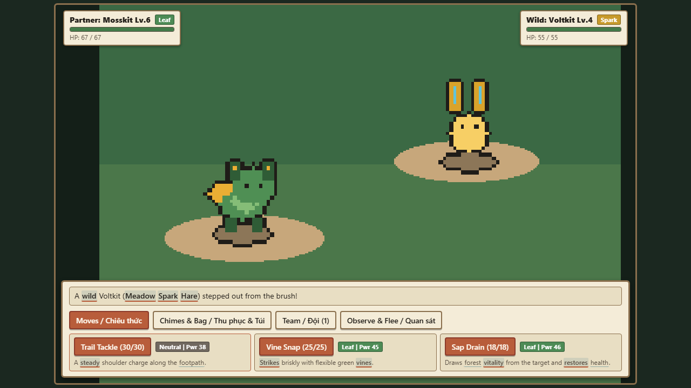
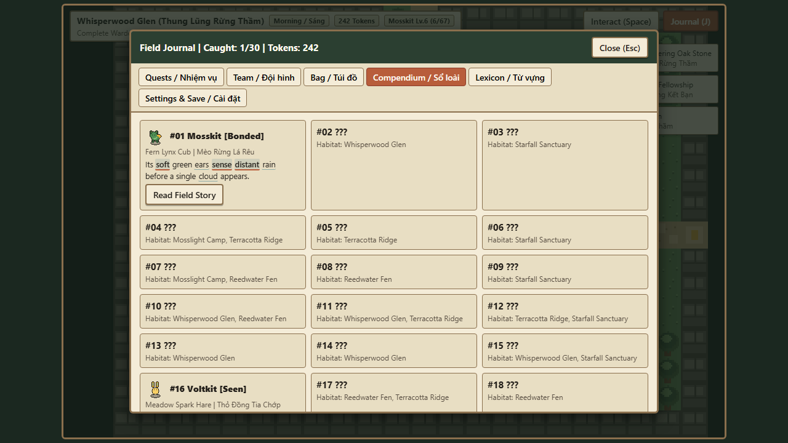

# LingoWild

LingoWild là trò chơi nhập vai thu phục sinh vật 2D chạy trực tiếp trên trình duyệt web, kết hợp việc tiếp thu tiếng Anh tự nhiên ngay trong ngữ cảnh thám hiểm. Người chơi dạo bước qua các vùng sinh thái, trò chuyện với đoàn kiểm lâm, đọc manh mối trên biển gỗ, chiến đấu theo lượt, kết bạn với sinh vật hoang dã bằng chuông cộng hưởng và khôi phục sự cân bằng cho Thung Lũng Rêu Xanh mà không bao giờ bị chặn tiến trình bởi các bài kiểm tra từ vựng bắt buộc.

## Tính năng đã triển khai và kiểm thử

- Thế giới liên thông: 1 khu trại trung tâm (`Mosslight Camp`) kết nối hai chiều với 4 vùng sinh thái (`Whisperwood Glen`, `Reedwater Fen`, `Terracotta Ridge`, `Starfall Sanctuary`), có chu kỳ sáng, trưa, chiều, đêm, rương tiếp tế ẩn và bếp lửa nghỉ chân.
- Hệ thống sinh vật và chiến đấu: 30 loài sinh vật nguyên bản (gồm 3 loài khởi đầu tiến hóa 3 bậc), 42 chiêu thức thuộc 6 nguyên tố cân bằng đối xứng, 4 trạng thái bất lợi, đổi đồng hành, quan sát tập tính, rút lui và thu phục bằng chuông cộng hưởng.
- Tuyến truyện hoàn chỉnh: 16 nhân vật phụ, 12 nhiệm vụ chính và phụ có điểm kết thúc rõ ràng, 3 Thủ lĩnh vùng cùng bài khảo nghiệm cuối tại Thánh Địa Sao Rơi.
- Tiếp thu tiếng Anh theo ngữ cảnh: 321 mục từ vựng Anh Việt đã biên tập kèm phiên âm, từ loại, ví dụ trong thế giới game và 174 đoạn hội thoại thực địa. Chạm vào bất kỳ từ tiếng Anh nào để xem nghĩa tiếng Việt, nghe phát âm (có hiển thị phiên âm dự phòng khi thiếu giọng đọc) và lưu từ tự nguyện để ôn tập nhẹ nhàng bên lửa trại.
- Giao diện Sổ Thực Địa và trợ năng: Hỗ trợ 3 chế độ ngôn ngữ (`Contextual`, `Full Bilingual`, `Immersion`), cấu hình mức gợi ý từ A1 đến B2, điều khiển bàn phím có thể đổi phím, cụm phím cảm ứng trên di động, chế độ tương phản cao, giảm chuyển động, cỡ chữ lớn và thanh chỉnh âm lượng riêng.
- Lưu trữ an toàn và chạy ngoại tuyến: Tự động lưu trên trình duyệt kèm mã kiểm tra toàn vẹn, tự khôi phục từ bản sao lưu khi dữ liệu lỗi, xuất và nhập tệp `.json`, hỗ trợ bộ nhớ đệm ngoại tuyến và tương thích đường dẫn tĩnh trên GitHub Pages.

## Ảnh chụp màn hình thực tế






Xem đầy đủ bộ 8 ảnh chụp thực tế trên máy tính và di động trong thư mục `docs/screenshots/`.

## Yêu cầu hệ thống và lệnh chạy

Cần cài đặt Node.js phiên bản `22.6` trở lên (đã kiểm thử trên Node.js `v24.14.0` và npm `11.9.0`).

```bash
# Cài đặt gói phụ thuộc an toàn từ tệp khóa phiên bản
npm ci --ignore-scripts

# Chạy máy chủ phát triển cục bộ (http://localhost:5173)
npm run dev

# Sinh tài nguyên pixel, kiểm định dữ liệu, kiểm tra kiểu và đóng gói bản phát hành vào dist/
npm run build

# Xem thử bản đóng gói sản phẩm (http://127.0.0.1:4173)
npm run preview

# Chạy kiểm tra quy tắc dự án, kiểm thử đơn vị, tích hợp và trình duyệt đầu cuối
npm run lint
npm test
npm run test:e2e
```

## Tài liệu dự án

- [Hướng dẫn chơi chi tiết](docs/HOW_TO_PLAY.md)
- [Quyết định kỹ thuật và phản biện giai đoạn 0](docs/TECHNICAL_DECISION.md)
- [Báo cáo kiểm thử và hiệu năng thực tế](docs/TEST_REPORT.md)
- [Danh mục kiểm tra bàn giao](docs/RELEASE_CHECKLIST.md)
- [Ghi công và nguồn gốc tài nguyên](CREDITS.md)
- [Nghiên cứu sản phẩm ban đầu](docs/RESEARCH.md)
- [Quy tắc triển khai](AGENTS.md)

## Giới hạn và lưu ý pháp lý

- Thời lượng hoàn thành tuyến chính khoảng 25 đến 45 phút nếu đi thẳng mục tiêu, hoặc 60 đến 90 phút khi khám phá trọn vẹn 30 loài, 12 nhiệm vụ và đọc toàn bộ hồ sơ thực địa.
- Trò chơi vận hành hoàn toàn phía máy khách cho một người chơi, không có máy chủ tài khoản hay đồng bộ đám mây tự động. Âm thanh dùng bộ tổng hợp Web Audio tối giản và giọng đọc phụ thuộc trình duyệt trên thiết bị.
- Mức độ A1 đến B2 trong cài đặt chỉ dùng để lọc gợi ý từ vựng trong trò chơi, không phải chứng chỉ đánh giá năng lực ngoại ngữ.
- Tên gọi LingoWild là tên làm việc tạm thời, chưa đăng ký nhãn hiệu. Dự án hoàn toàn độc lập và không có bất kỳ mối liên hệ nào với The Pokémon Company hay Nintendo.
