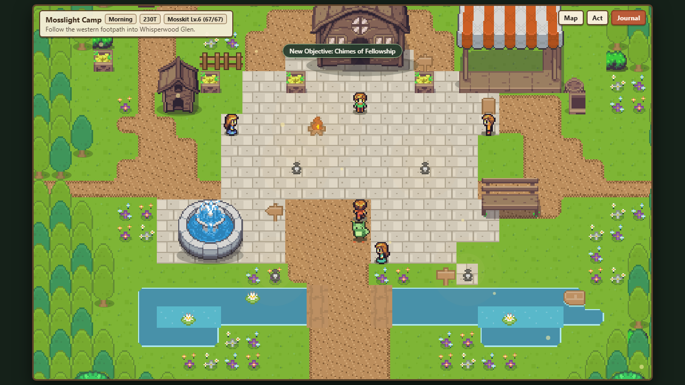
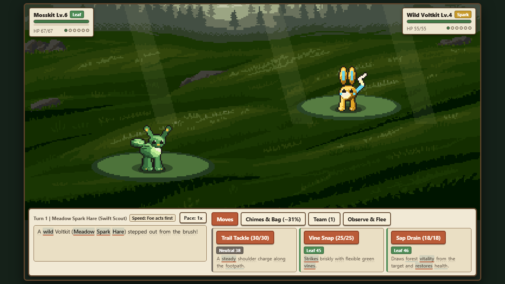
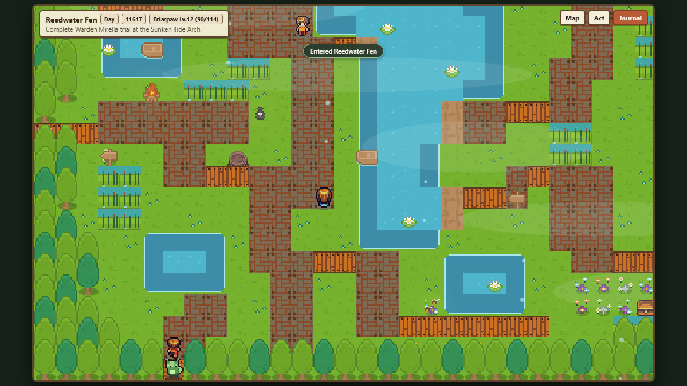
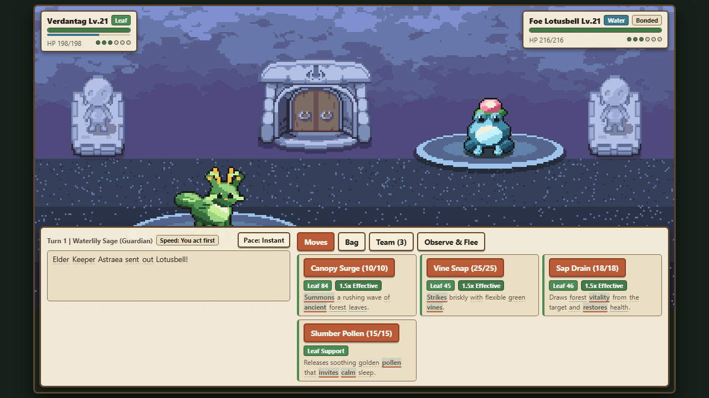
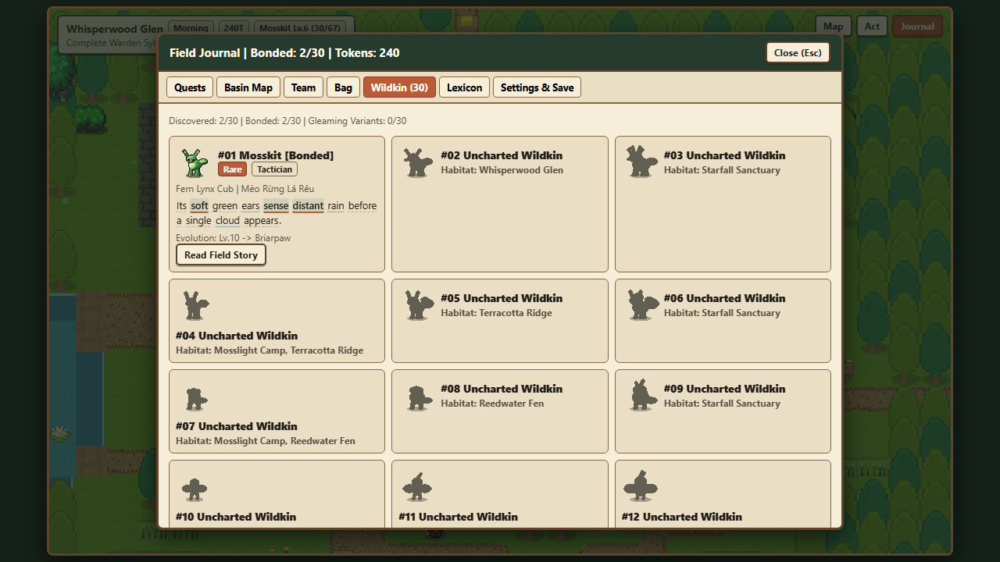
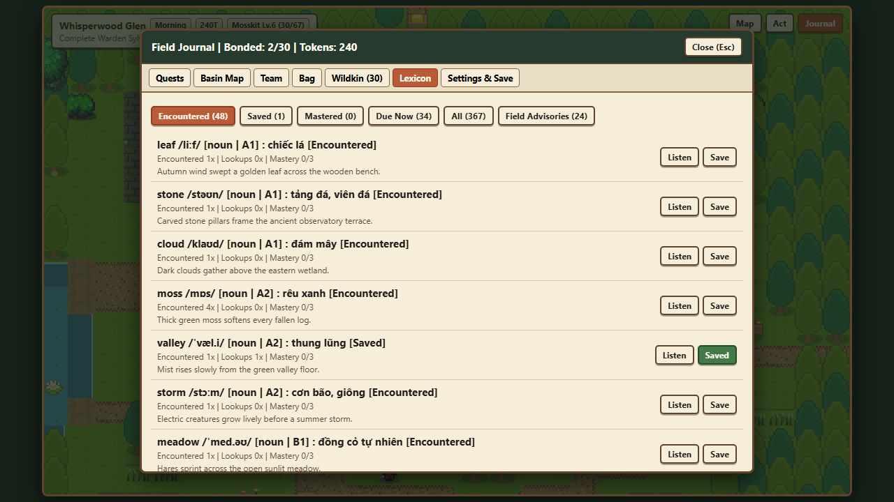

# LingoWild

LingoWild là trò chơi nhập vai thu phục sinh vật 2D chạy trực tiếp trên trình duyệt web, kết hợp tiếp thu tiếng Anh tự nhiên ngay trong ngữ cảnh thám hiểm. Người chơi dạo bước qua năm vùng sinh thái liên thông cùng bạn đồng hành đi theo sau lưng, trò chuyện với đoàn kiểm lâm, lần theo dấu vết sinh cảnh, chiến đấu theo lượt trên các sân đấu pixel, kết bạn với sinh vật hoang dã bằng chuông cộng hưởng và khôi phục sự cân bằng cho Thung Lũng Rêu Xanh mà không bao giờ bị chặn đường bởi bài kiểm tra từ vựng bắt buộc.

## 1. Điểm nhấn trải nghiệm trong bản phát hành cuối

- Thế giới 5 vùng sinh thái cỡ `32x24` có chiều sâu kiến trúc và phân lớp tán cây: Làng kiểm lâm `Mosslight Camp` có nhà trại gỗ `5x5`, đài phun nước đá hoạt ảnh ba nhịp, quầy chợ mái kẻ, ghế dài, chậu hoa và cụm sồi cổ thụ; `Whisperwood Glen` rậm rạp nhiều tầng cây với vệt nắng xuyên kẽ lá, thân cây đổ rỗng và nền đá lát phủ rêu; `Reedwater Fen` nối các đầm sen mờ sương bằng đường ván gỗ đa hướng có thanh chắn và nút giao ván ghép; `Terracotta Ridge` xếp tầng vách đá đất nung có gờ cát nắng, đường mòn đất đỏ tự nối 16 trạng thái và thác nước `3x3`; `Starfall Sanctuary` trang nghiêm với nền đá đen cổ ngữ, cổng vòm `4x4` và tượng đá hộ vệ.
- Hệ thống 30 loài sinh vật đổ bóng khối 4 sắc độ và bạn đồng hành thực địa: Toàn bộ 30 loài có hoạt ảnh hai nhịp trong trận đấu (`creatures.png`) và hình dáng thu nhỏ đặc trưng đi bộ theo sau người chơi trên bản đồ (`companions.png`); hỗ trợ biến thể ánh kim hiếm tự nhiên kèm hào quang vàng, 4 dấu vết sinh cảnh phát sáng mở gợi ý bách khoa, bóng dáng bí ẩn kèm vùng sống và thời điểm xuất hiện trước khi thu phục, màn ăn mừng tiến hóa và truyện ngắn thực địa cho các loài tiêu biểu.
- Chiến đấu chiến thuật hai cột chuẩn nhập vai và hậu cốt truyện: 42 chiêu thức thuộc 6 nguyên tố đối xứng trên 5 sân đấu pixel vẽ riêng cho từng vùng (`battle-bg.png`); bảng điều khiển chiến đấu chia hai cột gồm nhật ký thực địa kèm dự báo tốc độ ra đòn, cảnh báo bất lợi nguyên tố ở bên trái và bàn lệnh bốn chiêu thức, túi chuông hiển thị trực tiếp tỷ lệ thu phục ước tính ở bên phải, kèm thanh tiến độ kinh nghiệm ngay trên thẻ sinh vật của người chơi; mở khóa 4 trận tái đấu bậc thầy cấp `24` đến `30` sau khi hoàn thành cốt truyện.
- Tiếp thu tiếng Anh ngữ cảnh và giao tiếp đời thường: 367 mục từ và cụm từ thông dụng kèm giải nghĩa đa nghĩa theo ngữ cảnh, phiên âm, từ loại và câu ví dụ độc lập, kết hợp từ điển gốc từ bỏ túi ngoại tuyến hơn 430 mục (`src/data/pocket-dict.ts`) giúp chạm tra nghĩa của trên `90,5%` từ xuất hiện trong 192 đoạn hội thoại từ mức A1 đến B2.

## 2. Ảnh chụp màn hình thực tế và video gameplay

Video quay trực tiếp quá trình chơi thực tế từ màn hình mở đầu, chọn bạn đồng hành, chạm tra từ, dạo làng, vào rừng chiến đấu thu phục sinh vật tới Sổ Thực Địa được lưu tại [docs/videos/lingowild-gameplay.webm](docs/videos/lingowild-gameplay.webm).

















Trọn bộ 17 ảnh chụp thực tế của tất cả khu vực, hội thoại tra từ, lửa trại, màn kết thúc và di động ngang nằm trong thư mục [docs/screenshots/](docs/screenshots/).

## 3. Hướng dẫn chơi và điều khiển

### Chế độ hỗ trợ ngôn ngữ
Ngay tại màn hình mở đầu hoặc bất kỳ lúc nào trong thẻ Cài đặt, người chơi chọn mức độ câu thoại từ A1 đến B2 và một trong ba chế độ hiển thị:
- Chế độ Ngữ cảnh: Hiển thị tiếng Anh tự nhiên, gạch chân nhẹ các từ trọng tâm và cho phép chạm vào hầu hết từ vựng thông dụng trong câu để mở phiếu giải nghĩa, nghe phát âm hoặc lưu vào sổ.
- Chế độ Song ngữ: Hiển thị kèm dòng dịch tiếng Việt ngay dưới câu tiếng Anh trong hội thoại và nhật ký trận đấu.
- Chế độ Ngập tràn: Chỉ hiển thị tiếng Anh thuần túy và chỉ đánh dấu những từ do chính người chơi đã lưu.

### Điều khiển trên máy tính và di động
- Trên máy tính: Di chuyển bốn hướng bằng phím mũi tên hoặc `W`, `A`, `S`, `D`; tương tác với nhân vật, biển chỉ đường, rương đồ, dấu vết sinh cảnh và chuyển thoại bằng `Space` hoặc `Enter`; chọn nhanh bốn chiêu thức trong trận đấu bằng phím số `1`, `2`, `3`, `4`; mở nhanh Bản đồ vùng bằng phím `M`; mở Sổ Thực Địa bằng phím `J`; đóng cửa sổ bằng `Escape`. Các phím điều khiển chính đều cho phép gán lại trong thẻ Cài đặt.
- Trên điện thoại và máy tính bảng: Khung trò chơi tự động phủ kín màn hình dọc lẫn ngang mà không biến dạng tỷ lệ điểm ảnh. Cụm phím chữ thập bên trái hỗ trợ cả bấm từng bước lẫn nhấn giữ để bước đi liên tục; cụm nút hành động bên phải và thanh mục tiêu hai dòng phía trên cho phép thao tác gọn bằng ngón cái.

### Lộ trình 5 vùng và hậu cốt truyện
1. `Mosslight Camp`: Nhận một trong ba bạn đồng hành khởi đầu (`Mosskit`, `Kindlet`, `Ripplefin`) từ Trưởng đoàn Rowan, nhặt rương thảo dược và mua thêm chuông tại quầy tiếp tế.
2. `Whisperwood Glen`: Khảo sát dấu vỏ cây phát sáng của `Shellglow`, đọc manh mối hốc cây giúp Haru và vượt qua Thủ lĩnh Sylvan để nhận thẻ qua đò.
3. `Reedwater Fen`: Lần theo dấu chân bờ đầm, thắp sáng trụ đèn luồng nước giúp Sora và vượt qua Thủ lĩnh Mirella để nhận móc dây leo núi.
4. `Terracotta Ridge`: Khảo sát bia Lò Gốm Cổ giúp Amara, nhặt vật phẩm vách núi và vượt qua Thủ lĩnh Kaelen để nhận Ấn Cộng Hưởng.
5. `Starfall Sanctuary` và hậu cốt truyện: Đọc ba bia đá cổ giúp Lyra, vượt qua Trưởng lão Astraea và đánh thức Bệ Tinh Tú để khép lại cốt truyện chính. Sau màn tổng kết, người chơi tiếp tục hoàn thiện đủ 30 loài trong Sổ Bách Khoa, thu phục linh lộc `Solacern` và thách đấu 4 trận tái đấu bậc thầy cấp `24` đến `30` với Sylvan, Mirella, Kaelen cùng Astraea.

## 4. Kiến trúc hệ thống, lưu trữ an toàn và vận hành ngoại tuyến

Mã nguồn viết bằng TypeScript nghiêm ngặt (`strict: true`, `noUncheckedIndexedAccess: true`), tách biệt hoàn toàn tầng nghiệp vụ thuần khỏi giao diện hiển thị để kiểm thử xác định mà không phụ thuộc DOM hay WebGL:

| Thư mục hoặc tệp | Vai trò trong kiến trúc |
| --- | --- |
| `src/domain/` | Nghiệp vụ thuần: công thức nguyên tố, lượt đấu, xác suất thu phục, tiến hóa giữ chiêu chủ lực, di chuyển lưới, nhiệm vụ, lập lịch từ vựng và di trú tệp lưu |
| `src/data/` | Dữ liệu tĩnh đã kiểm định: 30 loài, 42 chiêu, 13 vật phẩm, 5 bản đồ `32x24`, 16 nhân vật phụ, 12 nhiệm vụ, 367 mục từ lõi, từ điển gốc từ bỏ túi và 192 hội thoại |
| `src/game/controller.ts` | Bộ điều phối trung tâm kết nối trạng thái trò chơi, đồng hành đi theo sau, lưu tự động, sự kiện âm thanh và giao diện |
| `src/scenes/WorldScene.ts` | Cảnh dựng hình Phaser 3 tự động chọn chế độ vẽ tối ưu theo phần cứng, phân lớp mặt đất, bóng đổ, vật thể, mái vòm tán cây, hạt môi trường và sân đấu |
| `src/ui/` | Giao diện Sổ Thực Địa, hộp thoại từ vựng tương tác, bảng lệnh chiến đấu hai cột và cụm điều khiển cảm ứng |
| `src/audio/soundEngine.ts` | Bộ tổng hợp nhạc nền theo vùng và hiệu ứng âm thanh bằng Web Audio API kết hợp đọc phát âm qua Web Speech API |
| `public/sw.js` và `scripts/inject-sw-manifest.ts` | Trình phục vụ ngoại tuyến định danh phiên bản `SHA-256` theo nội dung byte của danh sách tài nguyên sắp xếp xác định |

Các cơ chế an toàn dữ liệu và ngoại tuyến đã triển khai:
- Di trú tệp lưu tương thích ngược (`SAVE_SCHEMA_VERSION = 2`): Các bản lưu cũ từ phiên bản `1` được chuẩn hóa tự động; nếu vị trí đứng cũ trùng vào ô nay đã đặt đài phun nước hay công trình mới, thuật toán xoắn ốc tự dời nhân vật sang ô đi bộ hợp lệ gần nhất.
- Bảo vệ đa thẻ và đầy bộ nhớ: Trước khi ghi vào `localStorage`, hệ thống kiểm tra dấu thời gian mới hơn từ thẻ trình duyệt khác (`hasMultiTabConflict`) để tránh ghi đè mất tiến trình mới và cho phép đồng bộ ngược qua `syncFromNewerStorage`. Khi gặp lỗi đầy bộ nhớ `QuotaExceededError`, bản dự phòng hợp lệ trước đó luôn được giữ nguyên, và việc nhập tệp `.json` hỏng không bao giờ xóa mất bản lưu đang chơi.
- Ngoại tuyến tin cậy: `public/sw.js` chỉ quản lý các bộ nhớ đệm mang tiền tố `lingowild-cache-`, dùng chuỗi `async/await` tường minh trong `matchOfflineDocumentFallback` cho điều hướng trang và trả mã `503` rõ ràng cho tài nguyên con thất bại thay vì trả nhầm `index.html`.

## 5. Cơ chế tiếp thu tiếng Anh tự nhiên

- Chạm tra từ độ phủ cao không làm đứt mạch chơi: Bên cạnh 367 mục từ và cụm giao tiếp đời thường có biên soạn đa nghĩa theo ngữ cảnh (`resolveSenseForContext`), bộ tách hình thái từ kết hợp từ điển gốc từ ngoại tuyến hơn 430 mục (`src/data/pocket-dict.ts`) cho phép chạm xem nghĩa tiếng Việt của trên `90,5%` từ xuất hiện trong toàn bộ hội thoại.
- Câu ví dụ độc lập: Hàm `pickIndependentExample` ưu tiên chọn câu ví dụ khác với câu thoại người chơi vừa đọc và xoay vòng qua các lần mở phiếu từ để mở rộng ngữ cảnh sử dụng thực tế.
- Tách bạch điều kiện đủ thời hạn và điểm ưu tiên gặp lại từ: Trong `src/domain/learning.ts`, hàm `isWordDueForReencounter` kiểm tra nghiêm ngặt khoảng cách bước đi tối thiểu kể từ lần gặp trước (`12`, `28`, `55`, `110` bước ứng với bậc thành thạo `0` đến `3`), tách rời hoàn toàn khỏi hàm xếp hạng điểm ưu tiên `computeWordReencounterPriority`. Từ vừa gặp dù có điểm ưu tiên dương cũng không bị lặp lại sớm; từ đã thành thạo bậc `3` có chu kỳ nghỉ dài để nhường chỗ cho từ mới lưu đang đến hạn.
- Bốn bộ lọc rõ ràng và không ép kiểm tra: Sổ Từ Vựng tách riêng 4 trạng thái `Encountered`, `Saved`, `Mastered` và `Due Now`. Hoạt động ôn từ bên lửa trại là hoàn toàn tự nguyện; người chơi có thể hoàn tất 100% cốt truyện mà không cần trả lời bất kỳ câu hỏi từ vựng nào.

## 6. Nguồn tài nguyên mở và giấy phép

Mã nguồn dự án phát hành theo giấy phép MIT ([LICENSE](LICENSE)). Các bảng ảnh trong `public/assets/sprites/` được đóng gói xác định bằng `scripts/generate-assets.ts` từ các gói tài nguyên mở đã kiểm tra giấy phép lưu tại `assets-src/` cùng phần đồ họa vẽ riêng (xem chi tiết đầy đủ trong [CREDITS.md](CREDITS.md)):

| Bộ tài nguyên hoặc thành phần | Tác giả | Giấy phép | Phạm vi sử dụng trong LingoWild |
| --- | --- | --- | --- |
| `Roguelike/RPG Pack` | Kenney Vleugels | CC0 1.0 | Thảm cỏ, mặt nước động, bờ nước tự nối, cầu gỗ, thuyền neo, tán cây và lửa trại trong `tileset.png` |
| `Tiny 16: Basic` | Lanea Zimmerman (`Sharm`) | CC-BY 3.0 / 4.0 | Nhân vật bốn hướng trong `characters.png`, rương gỗ, bậc đá, đá lát rêu, vách đá phân tầng và ván cầu trong `tileset.png` |
| `Zelda-like tilesets and sprites` | ArMM1998 | CC0 1.0 | Nhà gỗ `5x5`, chòi gỗ, quầy chợ, cổng vòm đá cổ `4x4`, đài phun nước ba nhịp, ghế gỗ, thân cây rỗng, tượng đá và thác nước `3x3` trong `structures.png` |
| `Hazy Hills` và `Gothicvania Swamp` | Luis Zuno (`@ansimuz`) | CC-BY 3.0 và CC0 1.0 | Nền đồi rừng mờ sương và tán cây đầm lầy trong `battle-bg.png` |
| `Parallax Backgrounds` | Admurin | CC-BY 4.0 | Núi xa, đồng cỏ, bến cọc gỗ và đỉnh núi sao đêm trong `battle-bg.png` |
| `Sunset Temple Tiles` | Pyromantic | CC0 1.0 / CC-BY 3.0 | Tầng mây hoàng hôn hẻm núi cho sân đấu Đèo Đất Nung trong `battle-bg.png` |
| Sinh vật, đồng hành và hiệu ứng riêng | Nhóm phát triển LingoWild | MIT | 30 loài sinh vật `48x48` (`creatures.png`), 30 đồng hành `16x16` (`companions.png`), vật phẩm (`items.png`), hiệu ứng (`vfx.png`) và đường đất đỏ tự nối |

## 7. Kết quả kiểm thử thực tế, độ phủ mã nguồn và lệnh chạy

Yêu cầu hệ thống: Node.js từ `22.6` trở lên (đã kiểm định trên Node.js `v24.14.0`, npm `11.9.0` và quy trình GitHub Actions Ubuntu).

```bash
# Cài đặt gói phụ thuộc đúng phiên bản khóa
npm ci --ignore-scripts

# Kiểm tra lỗ hổng bảo mật cây phụ thuộc
npm audit --audit-level=low

# Chạy máy chủ phát triển tại http://localhost:5173
npm run dev

# Sinh 8 bảng ảnh pixel, kiểm định dữ liệu, kiểm tra kiểu, đóng gói dist/ và băm danh mục ngoại tuyến
npm run build

# Xem thử bản đóng gói chính thức tại http://127.0.0.1:4173
npm run preview

# Chạy kiểm tra quy tắc, kiểm thử đơn vị và tích hợp kèm độ phủ V8, kiểm thử trình duyệt đầu cuối
npm run lint
npm run test:coverage
npm run test:e2e
```

Tóm tắt kết quả kiểm định thực tế (báo cáo chi tiết tại [docs/TEST_REPORT.md](docs/TEST_REPORT.md)):
- Bảo mật và toàn vẹn dữ liệu: `npm audit --audit-level=low` ghi nhận `0` lỗ hổng; `npm run validate:data` xác nhận liên thông đường đi trên cả 5 bản đồ, đầy đủ 30 loài, 42 chiêu, 12 nhiệm vụ, 367 mục từ lõi và độ phủ tra từ hội thoại `90,5%`; `npm run lint` và `npm run typecheck` đạt `0` lỗi.
- Kiểm thử đơn vị, tích hợp và phá đảo cả 3 bạn đồng hành khởi đầu: Vượt qua `26/26` bài kiểm thử Vitest (`5/5` tệp), bao gồm 3 lượt chơi tự động từ đầu tới kết thúc bằng thao tác người chơi hợp lệ cho cả `Mosskit`, `Kindlet` và `Ripplefin`, kiểm thử di trú bản lưu cũ, đa thẻ trình duyệt và bộ lập lịch gặp lại từ.
- Độ phủ V8 theo đúng phạm vi được đo (`src/domain/**/*.ts` và `src/game/controller.ts`, không tính gộp giao diện DOM, cảnh Phaser hay tệp dữ liệu tĩnh): Toàn phạm vi được đo đạt `79,44%` câu lệnh, `83,31%` dòng mã, `82,77%` hàm và `73,83%` nhánh điều kiện; riêng tầng nghiệp vụ `src/domain/` đạt `88,66%` dòng mã và `92,53%` hàm, còn `src/game/controller.ts` đạt `70,55%` dòng mã.
- Kiểm thử trình duyệt đầu cuối và tích hợp liên tục: Bộ kiểm thử Playwright trên Chromium máy tính (`1280x720`) và điện thoại Pixel 7 dọc ngang (`412x915`, `915x412`) xác nhận phá đảo thực tế từ màn hình mở đầu tới đoạn kết mà không can thiệp trạng thái ngầm, nâng cấp trình phục vụ ngoại tuyến từ bản A sang bản B, mất mạng giữa phiên chơi, đường dẫn phụ `/Pokemon/` và chạy xanh hoàn toàn trên GitHub Actions của commit cuối.

## 8. Tài liệu dự án và giới hạn thực tế

Danh mục tài liệu đi kèm:
- [Hướng dẫn chơi chi tiết](docs/HOW_TO_PLAY.md)
- [Quyết định kỹ thuật và kiến trúc](docs/TECHNICAL_DECISION.md)
- [Báo cáo kiểm thử, độ phủ và đánh giá chơi thử](docs/TEST_REPORT.md)
- [Danh mục kiểm tra bàn giao phát hành cuối](docs/RELEASE_CHECKLIST.md)
- [Ghi công và nguồn gốc tài nguyên](CREDITS.md)
- [Nghiên cứu sản phẩm ban đầu](docs/RESEARCH.md)
- [Quy tắc triển khai](AGENTS.md)

Giới hạn thực tế và lưu ý pháp lý:
- Thời lượng hoàn thành cốt truyện chính khoảng 30 đến 50 phút nếu bám sát nhiệm vụ chính, hoặc 75 đến 110 phút khi khám phá trọn vẹn 30 loài, tìm đủ 4 dấu vết sinh cảnh, hoàn tất 12 nhiệm vụ và vượt qua 4 trận tái đấu bậc thầy sau cốt truyện.
- Trò chơi vận hành hoàn toàn phía máy khách cho một người chơi, lưu dữ liệu cục bộ trên trình duyệt kết hợp xuất nhập tệp `.json` thủ công, không có máy chủ tài khoản hay đồng bộ đám mây tự động.
- Nhạc nền tổng hợp trực tiếp bằng Web Audio API; chất lượng giọng đọc tiếng Anh qua Web Speech API phụ thuộc vào gói giọng nói có sẵn của hệ điều hành và trình duyệt trên thiết bị người dùng.
- Các mức từ A1 đến B2 trong cài đặt chỉ dùng để điều chỉnh độ phức tạp câu thoại và từ gợi ý trong trò chơi, không phải bài thi đánh giá năng lực ngoại ngữ và chưa thực hiện nghiên cứu thực nghiệm độc lập trên nhóm người học bên ngoài.
- LingoWild là tên làm việc tạm thời, chưa đăng ký nhãn hiệu. Dự án hoàn toàn độc lập và không có bất kỳ mối liên hệ nào với The Pokémon Company hay Nintendo.
