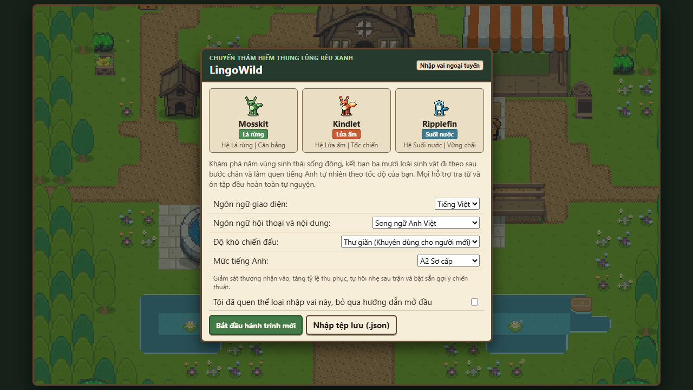
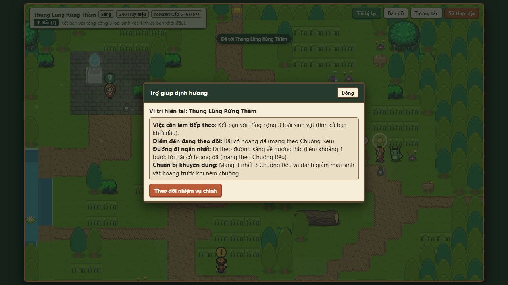
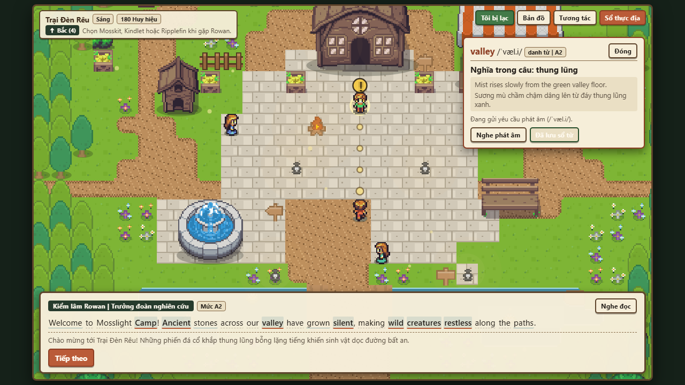
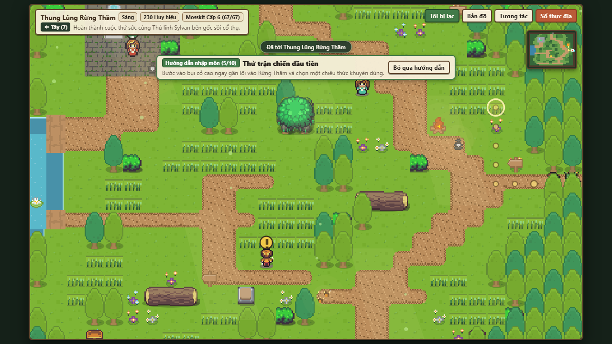
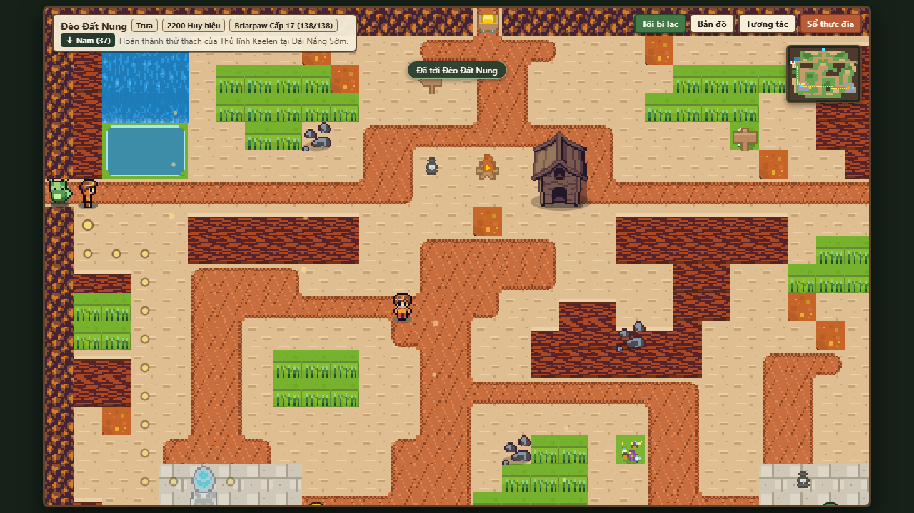
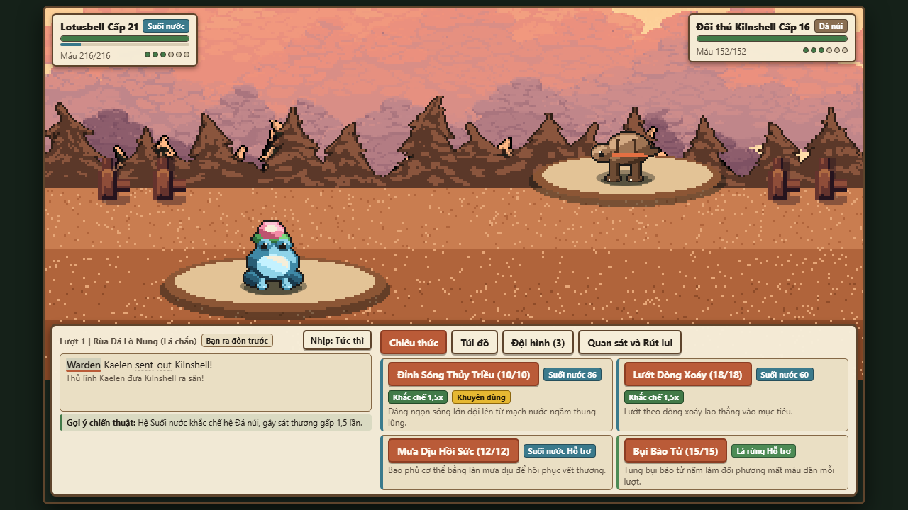

# LingoWild

LingoWild là trò chơi nhập vai thu phục sinh vật 2D chạy trực tiếp trên trình duyệt web, kết hợp tiếp thu tiếng Anh tự nhiên ngay trong ngữ cảnh thám hiểm. Trò chơi được thiết kế để người mới chưa từng chơi thể loại nhập vai thu phục sinh vật và đang ở trình độ tiếng Anh cơ bản có thể mở lên và chơi trôi chảy bằng tiếng Việt mà không cần đọc tài liệu ngoài, đồng thời dễ dàng nâng dần mức tiếp xúc tiếng Anh và độ khó chiến đấu theo nhịp riêng.

## 1. Điểm nhấn trải nghiệm và hỗ trợ người mới

- Tách độc lập ngôn ngữ giao diện, ngôn ngữ nội dung và độ khó chiến đấu: Người chơi mới mặc định bắt đầu với giao diện tiếng Việt đầy đủ, hội thoại song ngữ Anh Việt và độ khó Thư giãn. Bất kỳ lúc nào trên màn hình mở đầu hoặc trong thẻ Cài đặt, bạn đều có thể đổi giao diện giữa tiếng Việt và tiếng Anh, chọn một trong bốn chế độ nội dung (Tiếng Việt hoàn toàn, Song ngữ Anh Việt, Tiếng Anh có trợ giúp tra cứu, Đắm chìm trong tiếng Anh) và đổi độ khó chiến đấu mà không mất tiến trình hay dữ liệu từ vựng.
- Hệ thống dẫn đường theo ngữ cảnh ba mức (Đầy đủ, Tối giản, Tắt): Sử dụng thuật toán tìm đường ngắn nhất tránh chướng ngại vật và liên thông nhiều vùng qua các cổng đã mở khóa, hiển thị mũi tên định hướng kèm số bước trên thanh mục tiêu, vệt sáng dẫn đường mềm trên mặt đất, bản đồ nhỏ góc màn hình, dấu chấm than và dấu hỏi trên nhân vật có nhiệm vụ, gợi ý nút tương tác khi đứng gần, nút Dẫn đường trong từng nhiệm vụ và nút Tôi bị lạc giải thích ngay vị trí hiện tại cùng bước kế tiếp. Hệ thống tuyệt đối không tự dẫn tới rương bí mật chưa khám phá và chỉ báo yêu cầu khi gặp cổng đang khóa.
- Hướng dẫn nhập môn 10 bước tự nhiên, bỏ qua được bất kỳ lúc nào: Hướng dẫn từng bước từ chọn bạn đồng hành, di chuyển, trò chuyện, sang Rừng Thầm, trận chiến nhẹ cấp 3 đầu tiên, thu phục chắc chắn 100% ở lần bắt hướng dẫn đầu tiên, hồi phục tại lửa trại, chạm tra từ tiếng Anh tự nguyện (có nút bỏ qua bước riêng) tới mở Sổ Thực Địa. Có thể đánh dấu bỏ qua ngay từ màn hình mở đầu hoặc trong quá trình chơi mà không mất bất kỳ vật phẩm hay tiến trình nào.
- Ba chế độ độ khó cân bằng và Trợ giúp chiến đấu: Chế độ Thư giãn giảm sát thương địch, tăng tỷ lệ thu phục, tự hồi nhẹ sau trận và bật sẵn gợi ý chiến thuật; chế độ Phiêu lưu giữ cân bằng tiêu chuẩn; chế độ Thử thách nâng trí tuệ chọn chiêu của đối thủ mà không bơm máu vô nghĩa. Trợ giúp chiến đấu gợi ý chiêu khuyên dùng kèm giải thích khắc chế, cảnh báo máu thấp, gợi ý đổi đồng đội khắc hệ, ước lượng tỷ lệ thu phục trực tiếp, cảnh báo chuẩn bị trước khi gặp Thủ lĩnh và hỗ trợ quản lý đổi chiêu ngay trong thẻ Đội hình. Trợ giúp không bao giờ chơi hộ người chơi, và khi thua trận đội hình được hồi đầy tại lửa trại gần nhất không phạt mất huy hiệu.
- Thế giới 5 vùng sinh thái cỡ `32x24`, 30 loài sinh vật và hậu cốt truyện: Khám phá Trại Đèn Rêu, Thung Lũng Rừng Thầm, Đầm Sậy Nước Trong, Đèo Đất Nung và Thánh Địa Sao Rơi cùng bạn đồng hành đi theo sau lưng, 42 chiêu thức 6 nguyên tố trên 5 sân đấu pixel vẽ riêng, biến thể ánh kim hiếm, 4 dấu vết sinh cảnh, 12 nhiệm vụ kèm chi tiết mục tiêu rõ ràng và 4 trận tái đấu bậc thầy cấp `24` đến `30` sau cốt truyện.
- Tiếp thu tiếng Anh tự nhiên và hoàn toàn tự nguyện: 367 mục từ và cụm từ lõi đa nghĩa theo ngữ cảnh kèm phiên âm, từ loại và câu ví dụ độc lập, kết hợp từ điển gốc từ bỏ túi ngoại tuyến hơn 430 mục (`src/data/pocket-dict.ts`) đạt độ phủ chạm tra nghĩa `90,5%` trong 192 đoạn hội thoại từ A1 đến B2, không bao giờ chặn tiến trình bằng bài kiểm tra từ vựng bắt buộc.

## 2. Ảnh chụp màn hình thực tế và video gameplay

Video quay trực tiếp hành trình mở đầu của người chơi mới từ màn hình mở đầu tiếng Việt, chọn bạn đồng hành, theo đường sáng và bản đồ nhỏ gặp Trinh sát Mai, sang Rừng Thầm chiến đấu với Trợ giúp chiến đấu và thu phục chắc chắn sinh vật đầu tiên, hồi máu tại lửa trại, xem Sổ Thực Địa, quản lý chiêu thức, dùng nút Tôi bị lạc và đổi ngôn ngữ trực tiếp được lưu tại [docs/videos/lingowild-gameplay.webm](docs/videos/lingowild-gameplay.webm).
















Trọn bộ 22 ảnh chụp thực tế của tất cả khu vực, trải nghiệm người mới, hội thoại tra từ, lửa trại, sổ thực địa, màn kết thúc và di động dọc ngang nằm trong thư mục [docs/screenshots/](docs/screenshots/).

## 3. Hướng dẫn chơi và điều khiển

### Tùy chỉnh ngôn ngữ, độ khó và dẫn đường
Ngay tại màn hình mở đầu hoặc bất kỳ lúc nào trong thẻ `Cài đặt và Lưu` của Sổ Thực Địa, người chơi có thể thay đổi trực tiếp bốn thiết lập độc lập:
- Ngôn ngữ giao diện: Tiếng Việt hoặc Tiếng Anh.
- Ngôn ngữ hội thoại và nội dung: Tiếng Việt hoàn toàn, Song ngữ Anh Việt, Tiếng Anh có trợ giúp tra cứu hoặc Đắm chìm trong tiếng Anh (kèm mức câu thoại A1 đến B2).
- Độ khó chiến đấu: Thư giãn (khuyên dùng cho người mới), Phiêu lưu (cân bằng chuẩn) hoặc Thử thách (đối thủ đánh chiến thuật cao hơn).
- Mức dẫn đường và Trợ giúp chiến đấu: Chọn dẫn đường Đầy đủ, Tối giản hoặc Tắt; bật hoặc tắt thanh Trợ giúp chiến đấu và hướng dẫn nhập môn bất cứ lúc nào.

### Điều khiển trên máy tính và di động
- Trên máy tính: Di chuyển bốn hướng bằng phím mũi tên hoặc `W`, `A`, `S`, `D`; tương tác với nhân vật, biển chỉ đường, rương đồ, lửa trại và chuyển thoại bằng `Space` hoặc `Enter` (hỗ trợ tự quay mặt về đối tượng ngay cạnh); chọn nhanh bốn chiêu thức trong trận đấu bằng phím số `1`, `2`, `3`, `4`; mở nhanh Bản đồ vùng bằng phím `M`; mở Sổ Thực Địa bằng phím `J`; đóng cửa sổ bằng `Escape`. Các phím điều khiển chính đều gán lại được trong mục Cài đặt.
- Trên điện thoại và máy tính bảng: Khung trò chơi phủ kín màn hình dọc lẫn ngang không méo tỷ lệ điểm ảnh. Cụm phím chữ thập bên trái hỗ trợ bấm từng bước và nhấn giữ để bước liên tục; bản đồ nhỏ đặt gọn phía trên cụm nút cảm ứng bên phải để tránh che thanh mục tiêu và khung hướng dẫn phía trên.

### Lộ trình 5 vùng và hậu cốt truyện
1. Trại Đèn Rêu (`Mosslight Camp`): Nhận một trong ba bạn đồng hành khởi đầu (`Mosskit`, `Kindlet`, `Ripplefin`) từ Kiểm lâm Rowan, trò chuyện cùng Trinh sát Mai, nhặt rương nhà kính và mua thêm chuông tại quầy tiếp tế.
2. Thung Lũng Rừng Thầm (`Whisperwood Glen`): Thử trận chiến nhẹ cấp 3, kết bạn sinh vật đầu tiên, hồi phục bên lửa trại, khảo sát dấu vỏ cây phát sáng của `Shellglow`, đọc manh mối hốc cây giúp Haru và vượt qua Thủ lĩnh Sylvan để nhận thẻ qua đò.
3. Đầm Sậy Nước Trong (`Reedwater Fen`): Lần theo dấu chân bờ đầm, thắp sáng cột đèn kênh sương giúp Sora và vượt qua Thủ lĩnh Mirella để nhận móc dây leo núi.
4. Đèo Đất Nung (`Terracotta Ridge`): Khảo sát bia Lò Gốm Cổ giúp Amara, nhặt vật phẩm vách núi và vượt qua Thủ lĩnh Kaelen để nhận Ấn Cộng Hưởng.
5. Thánh Địa Sao Rơi (`Starfall Sanctuary`) và hậu cốt truyện: Đọc ba cột đá sao giúp Lyra, vượt qua Trưởng lão Astraea và đánh thức Đàn Hòa Âm Ánh Sao để khép lại cốt truyện chính. Sau màn tổng kết, người chơi tiếp tục thu phục đủ 30 loài, kết bạn linh lộc `Solacern` và thách đấu 4 trận tái đấu bậc thầy cấp `24` đến `30`.

## 4. Kiến trúc hệ thống, lưu trữ an toàn và vận hành ngoại tuyến

Mã nguồn viết bằng TypeScript nghiêm ngặt (`strict: true`, `noUncheckedIndexedAccess: true`), tách biệt hoàn toàn tầng nghiệp vụ thuần khỏi giao diện hiển thị để kiểm thử xác định mà không phụ thuộc DOM hay WebGL:

| Thư mục hoặc tệp | Vai trò trong kiến trúc |
| --- | --- |
| `src/domain/` | Nghiệp vụ thuần: bản địa hóa (`i18n.ts`), độ khó (`difficulty.ts`), tìm đường BFS và định hướng nhiệm vụ (`navigation.ts`), hướng dẫn nhập môn (`onboarding.ts`), trợ giúp chiến đấu (`battleAssist.ts`), công thức nguyên tố, lượt đấu, thu phục, quản lý chiêu thức, học từ vựng và di trú tệp lưu |
| `src/data/` | Dữ liệu tĩnh đã kiểm định: 30 loài, 42 chiêu kèm tên tiếng Việt, 13 vật phẩm, 5 bản đồ `32x24`, 16 nhân vật phụ, 12 nhiệm vụ, 367 mục từ lõi, từ điển gốc từ bỏ túi và 192 hội thoại |
| `src/game/controller.ts` | Bộ điều phối trung tâm kết nối trạng thái trò chơi, đồng hành đi theo sau, cập nhật dẫn đường theo sự kiện rời rạc, lưu tự động, sự kiện âm thanh và giao diện |
| `src/scenes/WorldScene.ts` | Cảnh dựng hình Phaser 3 vẽ bản đồ phân lớp, vệt sáng dẫn đường lưu đệm theo chữ ký, dấu nhiệm vụ trên nhân vật, hạt môi trường và sân đấu pixel |
| `src/ui/` | Giao diện tiếng Việt và tiếng Anh đầy đủ cho màn hình mở đầu, thanh mục tiêu kèm la bàn và bản đồ nhỏ, Sổ Thực Địa 7 thẻ, hộp thoại từ vựng, cửa sổ Tôi bị lạc và bảng chiến đấu hai cột |
| `src/audio/soundEngine.ts` | Bộ tổng hợp nhạc nền theo vùng và hiệu ứng âm thanh bằng Web Audio API kết hợp đọc phát âm qua Web Speech API |
| `public/sw.js` và `scripts/inject-sw-manifest.ts` | Trình phục vụ ngoại tuyến định danh phiên bản `SHA-256` theo nội dung byte của danh sách tài nguyên sắp xếp xác định |

Các cơ chế an toàn dữ liệu và ngoại tuyến đã triển khai:
- Di trú tệp lưu tương thích ngược (`SAVE_SCHEMA_VERSION = 2`): Bản lưu cũ từ phiên bản `1` và `2` thiếu các trường trải nghiệm người mới được tự động bổ sung giá trị an toàn (giữ nguyên độ khó Phiêu lưu và đánh dấu bỏ qua hướng dẫn nhập môn nếu đã chọn bạn đồng hành, đồng thời dời nhân vật ra khỏi ô công trình mới nếu bị chặn).
- Bảo vệ đa thẻ và đầy bộ nhớ: Kiểm tra dấu thời gian mới hơn từ thẻ trình duyệt khác (`hasMultiTabConflict`) để tránh ghi đè mất tiến trình mới, giữ nguyên bản sao lưu dự phòng khi gặp lỗi đầy bộ nhớ `QuotaExceededError` và bảo toàn bản lưu đang chơi khi nhập nhầm tệp `.json` hỏng.
- Ngoại tuyến tin cậy: `public/sw.js` chỉ quản lý kho đệm mang tiền tố `lingowild-cache-`, dùng `async/await` tường minh cho dự phòng điều hướng ngoại tuyến và trả mã `503` rõ ràng cho tài nguyên con thất bại.

## 5. Nguồn tài nguyên mở, giấy phép mã nguồn và giấy phép hình ảnh

Dự án phân biệt rõ ràng giữa giấy phép mã nguồn phần mềm và giấy phép các gói tài nguyên hình ảnh bên thứ ba (xem đầy đủ liên kết gốc và ghi chú chỉnh sửa trong [CREDITS.md](CREDITS.md)):

- Giấy phép mã nguồn và dữ liệu nguyên bản: Toàn bộ mã nguồn TypeScript, kịch bản kiểm thử, cấu hình đóng gói, âm thanh tổng hợp Web Audio cùng dữ liệu hội thoại, từ vựng và cốt truyện biên soạn mới của dự án được cấp phép theo giấy phép MIT trong tệp [LICENSE](LICENSE).
- Giấy phép hình ảnh vẽ nguyên bản của dự án: Các bảng ảnh sinh vật chiến đấu `creatures.png`, đồng hành đi theo sau `companions.png`, dấu vết sinh cảnh, gạch đá đen cổ ngữ, đường đất đỏ tự nối và hiệu ứng riêng trong `items.png`, `vfx.png` do nhóm phát triển vẽ mới và cấp phép theo giấy phép MIT cùng mã nguồn.
- Giấy phép hình ảnh từ các bộ tài nguyên mở bên thứ ba: Các tệp ảnh nguồn trong `assets-src/` và khung hình trích xuất vào `tileset.png`, `structures.png`, `characters.png`, `battle-bg.png` giữ nguyên giấy phép gốc của từng tác giả (CC0 1.0 và CC-BY 3.0 hoặc CC-BY 4.0 lưu tại `assets-src/sharm-tiny16-ccby/ATTRIBUTION.txt` và `assets-src/battle-backgrounds/ATTRIBUTION.txt`).

| Bộ tài nguyên hoặc thành phần | Tác giả | Giấy phép áp dụng | Phạm vi sử dụng trong LingoWild |
| --- | --- | --- | --- |
| Mã nguồn, dữ liệu ngôn ngữ và âm thanh tổng hợp | Nhóm phát triển LingoWild | MIT ([LICENSE](LICENSE)) | Toàn bộ mã trong `src/`, `scripts/`, `tests/`, `public/sw.js` và dữ liệu hội thoại, từ vựng |
| Sinh vật, đồng hành và hiệu ứng vẽ riêng | Nhóm phát triển LingoWild | MIT ([LICENSE](LICENSE)) | 30 loài sinh vật `48x48` (`creatures.png`), 30 đồng hành `16x16` (`companions.png`), vật phẩm (`items.png`), hiệu ứng (`vfx.png`) và đường đất đỏ tự nối |
| `Roguelike/RPG Pack` | Kenney Vleugels | CC0 1.0 Universal | Thảm cỏ, mặt nước động, bờ nước tự nối, cầu gỗ, thuyền neo, tán cây và lửa trại trong `tileset.png` |
| `Zelda-like tilesets and sprites` | ArMM1998 | CC0 1.0 Universal | Nhà gỗ `5x5`, chòi gỗ, quầy chợ, cổng vòm đá cổ `4x4`, đài phun nước ba nhịp, ghế gỗ, thân cây rỗng, tượng đá và thác nước `3x3` trong `structures.png` |
| `Tiny 16: Basic` | Lanea Zimmerman (`Sharm`) | CC-BY 3.0 / CC-BY 4.0 | Nhân vật bốn hướng trong `characters.png`, rương gỗ, bậc đá, đá lát rêu, vách đá phân tầng và ván cầu trong `tileset.png` |
| `Hazy Hills` và `Gothicvania Swamp` | Luis Zuno (`@ansimuz`) | CC-BY 3.0 và CC0 1.0 | Nền đồi rừng mờ sương (CC-BY 3.0) và tán cây đầm lầy (CC0 1.0) trong `battle-bg.png` |
| `Parallax Backgrounds` | Admurin | CC-BY 4.0 | Núi xa, đồng cỏ, bến cọc gỗ và đỉnh núi sao đêm trong `battle-bg.png` |
| `Sunset Temple Tiles` | Pyromantic | CC0 1.0 / CC-BY 3.0 | Tầng mây hoàng hôn hẻm núi cho sân đấu Đèo Đất Nung trong `battle-bg.png` |

## 6. Kết quả kiểm thử thực tế, độ phủ mã nguồn và lệnh chạy

Yêu cầu hệ thống: Node.js từ `22.6` trở lên (đã kiểm định trên Node.js `v24.14.0`, npm `11.9.0` và quy trình GitHub Actions Ubuntu).

```bash
# Cài đặt gói phụ thuộc đúng phiên bản khóa
npm ci --ignore-scripts

# Kiểm tra lỗ hổng bảo mật cây phụ thuộc
npm audit --audit-level=low

# Chạy máy chủ phát triển tại http://localhost:5173
npm run dev

# Sinh 8 bảng ảnh pixel, kiểm định dữ liệu, kiểm tra kiểu, đóng gói dist/ và băm danh mục ngoại tuyến
npm run build

# Xem thử bản đóng gói chính thức tại http://127.0.0.1:4173
npm run preview

# Chạy kiểm tra quy tắc, kiểm thử đơn vị và tích hợp kèm độ phủ V8, kiểm thử trình duyệt đầu cuối
npm run lint
npm run test:coverage
npm run test:e2e
```

Tóm tắt kết quả kiểm định tự động (báo cáo chi tiết tại [docs/TEST_REPORT.md](docs/TEST_REPORT.md)):
- Bảo mật và toàn vẹn dữ liệu: `npm audit --audit-level=low` đạt `0` lỗ hổng; `npm run validate:data` xác nhận liên thông 5 bản đồ, đủ 30 loài, 42 chiêu, 12 nhiệm vụ, 367 mục từ lõi và độ phủ tra từ `90,5%`; `npm run lint` và `npm run typecheck` đạt `0` lỗi.
- Kiểm thử đơn vị và tích hợp (`vitest`): Vượt qua `35/35` bài kiểm thử (`6/6` tệp), bao gồm 3 lượt phá đảo tự nhiên cho cả `Mosskit`, `Kindlet` và `Ripplefin` ở độ khó Phiêu lưu, cùng 9 nhóm kiểm thử chuyên sâu cho trải nghiệm người mới (bản địa hóa, 3 độ khó, tìm đường BFS tránh vật cản và chặn cổng khóa, hướng dẫn 10 bước, bắt chắc chắn 100%, Trợ giúp chiến đấu, đổi chiêu và di trú bản lưu cũ).
- Độ phủ V8 theo đúng phạm vi được đo (`src/domain/**/*.ts` và `src/game/controller.ts`, không tính giao diện DOM, cảnh Phaser hay dữ liệu tĩnh): Toàn phạm vi được đo đạt `77,66%` câu lệnh, `80,38%` dòng mã, `72,50%` nhánh và `59,79%` hàm (tỷ lệ hàm chịu ảnh hưởng từ các hàm định dạng chuỗi giao diện trong `src/domain/i18n.ts` vốn được chạy trực tiếp trong bộ kiểm thử trình duyệt Playwright; các mô-đun nghiệp vụ lõi như `battle.ts`, `battleAssist.ts`, `capture.ts`, `difficulty.ts`, `navigation.ts`, `onboarding.ts`, `learning.ts` đạt từ `82%` đến `100%` dòng mã).
- Kiểm thử trình duyệt đầu cuối (`playwright`): Vượt qua toàn bộ `11/11` bài kiểm thử hoạt động trên Chromium máy tính (`1280x720`) và điện thoại Pixel 7 dọc ngang (`412x915`, `915x412`), bao gồm kịch bản mô phỏng người mới trình độ tiếng Anh A1 hoàn thành toàn bộ hướng dẫn mở đầu chỉ bằng thông tin trong game, kiểm tra không lọt nhãn tiếng Anh trong giao diện tiếng Việt, đổi ngôn ngữ và độ khó giữa trận không mất dữ liệu, bỏ qua hướng dẫn không mất vật phẩm, phá đảo toàn bộ cốt truyện và nâng cấp trình phục vụ ngoại tuyến từ bản A sang bản B.

## 7. Hướng dẫn phát hành trên GitHub Pages

Kho mã đã cấu hình đường dẫn tương đối `base: './'` trong `vite.config.ts`, trình phục vụ ngoại tuyến tương thích đường dẫn con `/Pokemon/` và quy trình tự động hóa tại `.github/workflows/ci-and-deploy.yml`:

1. Bật nguồn phát hành trên GitHub: Mở kho mã trên GitHub, vào `Settings`, chọn `Pages`, tại phần `Build and deployment` đặt `Source` là `GitHub Actions`.
2. Duyệt và gộp nhánh phát hành: Rà soát pull request từ nhánh `develop/lingowild` sang `main`, xác nhận bước `verify-and-build` chạy xanh rồi bấm `Merge pull request`.
3. Triển khai tự động: Ngay khi `main` nhận commit mới, quy trình sẽ chạy lại kiểm định bảo mật, đóng gói `./dist`, chạy kiểm thử đầu cuối và tự động xuất bản lên `https://nguyen-xuantung.github.io/Pokemon/`.
4. Kiểm tra sau phát hành: Mở trang trên máy tính hoặc điện thoại để trình phục vụ ngoại tuyến lưu đệm 14 tài nguyên tĩnh, rồi tải lại trang để kiểm tra hoạt động ngoại tuyến.

## 8. Tài liệu dự án và giới hạn thực tế

Danh mục tài liệu đi kèm:
- [Hướng dẫn chơi chi tiết](docs/HOW_TO_PLAY.md)
- [Quyết định kỹ thuật và kiến trúc](docs/TECHNICAL_DECISION.md)
- [Báo cáo kiểm thử, độ phủ và đánh giá chơi thử](docs/TEST_REPORT.md)
- [Danh mục kiểm tra bàn giao phát hành cuối](docs/RELEASE_CHECKLIST.md)
- [Ghi công và nguồn gốc tài nguyên](CREDITS.md)
- [Nghiên cứu sản phẩm ban đầu](docs/RESEARCH.md)
- [Quy tắc triển khai](AGENTS.md)

Giới hạn thực tế và lưu ý:
- Toàn bộ kiểm chứng hiện tại là kiểm thử tự động và tự rà soát trực tiếp của nhóm phát triển; sản phẩm chưa được thử nghiệm định lượng trên nhóm người chơi mới hoàn toàn bên ngoài.
- Thời lượng hoàn thành cốt truyện chính khoảng 30 đến 50 phút, hoặc 75 đến 110 phút khi khám phá đủ 30 loài, 12 nhiệm vụ và 4 trận tái đấu bậc thầy.
- Trò chơi vận hành hoàn toàn phía máy khách cho một người chơi, lưu dữ liệu cục bộ kèm xuất nhập tệp `.json` thủ công, không có tài khoản trực tuyến hay đồng bộ đám mây.
- Chất lượng giọng đọc tiếng Anh qua Web Speech API phụ thuộc vào gói giọng nói có sẵn của từng hệ điều hành và trình duyệt.
- LingoWild là tên làm việc tạm thời, chưa đăng ký nhãn hiệu và hoàn toàn độc lập với The Pokémon Company hay Nintendo.
